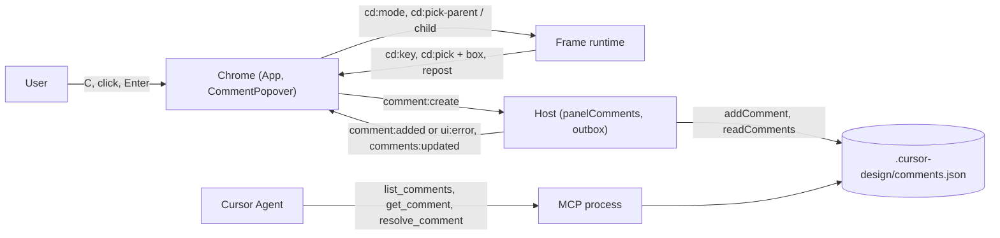
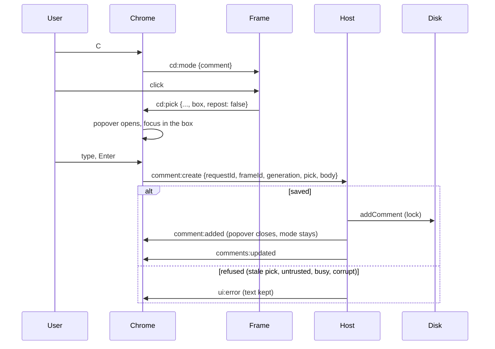

# Feature 8f1: Comment mode + popover - Overview for review

> **Generated file.** Human-facing steering summary of the active work item:
> same content as `current-feature.md`, trimmed. Written at `/feature` when the
> spec is created, and kept current if the spec is revised. `/complete` may
> polish this into the archive-ready one-pager; it is not the first write.
> Open in Markdown preview to render the diagrams.

Source of truth: `blueprint/history/features/08f1-comment-mode-popover.md`. This file is the
steering summary, not the build spec.

## TL;DR

- **`C` toggles Comment mode**, from the toolbar or with focus inside a frame. Escape leaves it.
- **A click opens a popover** on the element: target chip, Parent / Child, a text box, Add comment
  and Cancel.
- **Keys follow D3:** ↑ / ↓ step to the parent or child while the box is empty, Enter adds,
  Shift+Enter is a new line, the first Escape cancels and a second leaves the mode.
- **Add writes `comments.json`** through the host and the 8e `addComment`. A failed save or an
  Agent edit meanwhile keeps your text ("Pick it again").
- **The panel now receives the comment list**, on open, on every disk change and on reload. A
  broken `comments.json` shows its own banner and the frames keep rendering.
- Nothing is drawn on the canvas after Add yet: pins are 8f2, the Comments panel 8g.

## System map

## Key loop

## What you will see

- The Comment button titled "Comment (C)"; in Comment mode the toolbar says "Click to comment."
- The popover, flipped to stay inside the stage, with one message line for a host error or the
  reason Add is blocked (no unique selector, out of view, no version yet).
- A second red banner line when `comments.json` cannot be read.

## Decisions locked

- The host answers each create exactly once, `comment:added` or `ui:error`, matched by a UUID
  `requestId`; answers are never replayed after a reload.
- `cd:pick` says whether it is a user pick or a scroll / resize re-post; re-posts never open or
  move the popover to another frame.
- The stored pin is a fraction of the element's unclipped `box`, so a clipped target pins right.
- The panel list has no stale / missing flags until 8f2.
- Page comments are never stale (decided 2026-10-26).

## Out of scope

Pins and flags (8f2), the Comments panel (8g), Copy prompt (8h), keeping a draft across a webview
reload (tab hide / show), a pending-save timeout.

## Glossary

| Term | Why it exists |
|---|---|
| Comment mode | Clicks pick elements instead of acting, so you can point at what to change |
| Pick | The element you clicked, with its selector, text, styles and position |
| Draft | The open popover's target and text, until Add or Cancel |
| Generation | The artboard version; a pick from an older one is refused ("Pick it again") |
| `requestId` | Ties the host's answer to the save that asked, so a late answer never closes the wrong draft |

## Your actions

- Accepted as not run (2026-10-27): the untrusted-workspace refusal, panel close / reopen and
  hide / show replay, the real corrupt / version-99 banner, and the "no version yet" copy in F5.
- Open follow-ups: F-83 and F-84 (P3, missing host tests) stay in the findings ledger.

## Done means

`pnpm verify` and 59 browser tests pass. The F5 Cursor Agent run passed T2–T6, T8–T11 (MCP side)
and your manual key, focus, wheel and CSP checks. The independent review (Sonnet 5.5, fresh
subagent) passed with no P0 / P1 finding.
