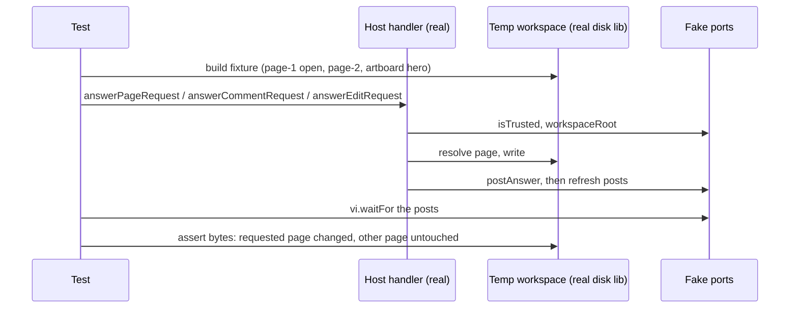

# Host tests on real disk (11c2) - Overview for review

Source of truth: `blueprint/history/features/11c2-host-tests-on-real-disk.md`. This file is the
steering summary, not the build spec.

## TL;DR

The panel request and refresh tests stopped checking mocks and started checking disk. Five host test
files (`artboardDisk`, `refreshPanel`, `panelPages`, `panelComments`, `panelEdit`) now run on a real
temp workspace with the fake ports from 11c1. Across the six host request and refresh test files
there are 0 `vi.mock` (32 before 11c1, 15 after it). The product behaves exactly as before. The one
source edit is an audit repair: the edit-message mapping `toArtboardEdit` moved, unchanged, into
`chromeMessages.ts` with its own unit test.

## Key loop

## What you will see

Nothing in the product. In the tests: "this file on disk now says X" in place of "this mock was called
with Y". Six host test files plus `chromeMessages.test.ts` changed. 892 tests, up from 882. The six
files run in about 3.2 s.

## Decisions locked

- **Test-only**, except the F-08 repair above. A test that needed a source seam, a module mock or a spy
  would have stopped the build. None did.
- **Writes nothing** = a byte-for-byte tree compare of the temp root.
- **Never resolved** = a tripwire workspace whose index is lost: any resolve rebuilds `project.json`,
  so an identical tree proves the refusal came first. Used only where no trusted refresh follows.
- **Fixtures** come from the disk lib in a fixed order. Broken states (`{` in a JSON file, a
  directory in place of the `artboards` tombstone) are hand-written.
- **Background refreshes** are awaited with `vi.waitFor` on the fake post (5 s timeout), never a
  sleep.
- **Proof:**
  - 24 one-line source probes from the spec, plus one each for F-06 and F-08, each turned a test
    red and were reverted.
  - The six files passed 3 runs in a row, 4 concurrent runs and 3 shuffled-order runs.
- **Every finding fixed**, by Bombic's call: F-01..F-12 closed by fresh re-reviews, none accepted.

## Out of scope

`canvasSnapshot.test.ts` / `hostFs.test.ts` mocks (kept by plan), the watcher (11c3), webview ports
(11c4), the message guard (11d).

## Glossary

| Term | Why it exists |
|------|---------------|
| Fake ports | The test stand-in for `PanelPorts` (trust, root, log, posts, clipboard, modal) |
| Tripwire workspace | A folder whose `project.json` is gone, so any page resolve visibly rewrites it |
| Probe | A deliberate one-line bug in the source; a good test turns red on it |

## Done means

`pnpm verify` passes (74 files, 892 tests). Build-plan 11c2 is checked; parent 11 stays open
(11c3, 11c4, 11d, 11e remain).
