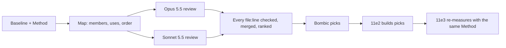

# Comments review report (11e1) - Overview for review

Source of truth: `blueprint/history/features/11e1-comments-review-report.md`. This file is the steering summary, not the build spec. The report itself: `blueprint/reference/11e-comments-review.md`.

## TL;DR

Question: can `CommentsState`, `PinThread` and `CommentPicker` become one comments module with a small interface? **No.** One class would be about 785 lines with three jobs, and a facade would only forward the ~58 things `DesignPage` hands its views. Only 6 of 66 cross-class uses run between the three classes. The win is narrowing those seams, not merging. No code changed in 11e1.

## What you will see

- A new report with a reproducible Baseline (sizes, exports, interfaces, cross-class uses, order constraints, test metrics, Stage and Inspector sizes for 11e3), a Map of the comments code with `file:line`, 7 ranked candidates, 3 disputed points and 12 rejected ideas.
- `build-plan.md`: 11e split into 11e1 (done), 11e2 (build the picks), 11e3 (Stage and Inspector helpers, re-measure).

## Flow

## Decisions locked

- **Picked for 11e2 (2026-11-27):** C1 one answer entry on `CommentsState`; C2 delete the held-draft paths that can never run and make unused members private; C3 one draft-pick entry on `PinThread` (its missing browser guard first); C4 variant (a) card callbacks take the id; C5 jump view as a pure, tested rule.
- **Not picked:** C4 (b), C6 focus-predicate module, C7 rename, D1 to D3.
- **C2 tier override:** kept Strong although only its "make private" half had both reviewers' agreement; the dead-path half was verified end to end by the builder and the audit.
- **Item 11 wording** now says "comments seams narrowed" instead of "comments behind one small interface".

## Out of scope

Any code change (11e2), Stage and Inspector extraction (11e3), host comments, messages, disk, MCP, the frame runtime.

## Glossary

| Term | Why it exists |
|---|---|
| Deletion test | Imagine a module gone: if its complexity vanishes it was a pass-through; if it reappears in callers it earns its keep |
| Cross-class use | One file touching another comments class's member; the coupling the report counts |
| Held draft / thread | A comment draft or open thread restored after a webview reload, waiting until it can be shown |

## Done means

Report committed with picks recorded; `pnpm verify` passes (75 files, 926 tests); audit findings 11e1/F-01 to F-12 closed, F-13 invalid.
