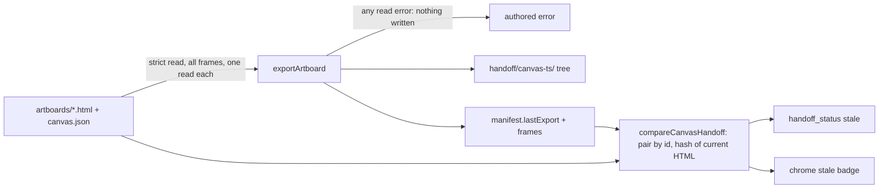

# Canvas export - Overview for review

Source of truth: `blueprint/history/features/06e-canvas-export.md`. This file is the steering summary, not the build spec.

## Goal

Export the whole canvas, not just the active artboard. One handoff folder holds:
- every frame as its own untouched `index.html`, grouped by `group`;
- an `IMPLEMENT.md` index;
- a view-only `canvas.html` preview.

The handoff goes stale when any frame's HTML changes or a frame is added or removed.

## What you will see

- **Export Handoff** (or the Agent's `export_artboard`) writes `.cursor-design/handoff/canvas-<timestamp>/`. It never needs an active artboard to decide what to export.

  ```
  IMPLEMENT.md          index: groups → frames (label, id, width, hash, file)
  canvas.html           open in Chrome: labeled frames + group headings at their layout positions
  tokens.json
  desktop/hero/index.html
  mobile/hero-alt/index.html
  ungrouped/t5-short/index.html
  ```

- The "Handoff out of date" badge appears when any frame's HTML changes, including a hand edit to the HTML file, or when a frame is added or deleted. Moving, resizing, relabeling or reordering frames does not trigger it.
- `export_artboard` no longer takes `artboardId`. Passing one returns an error telling the Agent to omit it.

## In / out at a glance

| In | Out |
|---|---|
| Whole-canvas export from MCP + command | Exporting one frame or a subset |
| Folder per group, `ungrouped/`, collisions get `-2`, `-3` | Layout-only changes marking stale |
| Byte-equal pristine `index.html` per frame | Pan/zoom in `canvas.html` |
| `IMPLEMENT.md` index, static `canvas.html` | Copying `assets/`, deleting old handoffs |
| `manifest.lastExport.frames` (legacy fields kept) | 6f reference dogfood |
| One stale rule for `handoff_status` + badge | New MCP tools, `canvas.json` changes |
| `zod` for manifest/meta parsing in `parse.ts` | Zod for `canvas.json`, MCP inputs, chrome |

## Data flow



## Locked decisions

- **Frame set:** exactly what `list_artboards` returns, in that order. Orphan `canvas.json` entries are already dropped there. A missing `canvas.json` just auto-places every artboard.
- **Export id:** `canvas-<compact ISO time>`.
- **Group folders:**
  - Lowercase slug of the group name.
  - `ungrouped/` is for frames with no group. An empty group string counts as no group; a whitespace-only group is a real group, as in the panel.
  - Collisions get the first free `-2`, `-3`.
  - In `IMPLEMENT.md` the no-group section is titled `(no group)`, so it never clashes with a group someone named "Ungrouped".
- **Pristine:** each `index.html` is the exact disk HTML string, read once. Tests assert byte-equality.
- **All-or-nothing reads:** a broken `canvas.json`, an unreadable frame, a corrupt meta file, or zero artboards fails before any file is written. A *missing* meta file is fine, and export creates it.
- **Stale check:**
  - Frames are matched by id, so order doesn't matter.
  - It always hashes the current HTML, never a stored meta hash, so MCP and the badge agree.
  - An old export without a frame list counts as a one-frame export.
- **Legacy manifest fields** (`artboardId`, `artboardHash`) are filled from the active frame, or the first frame, so 0.1 readers still work.
- **Errors:**
  - Every error has authored copy.
  - "No artboards to export" is its own error type.
  - The command shows authored messages and logs anything else.
- **Zod, scoped:**
  - Step 0 adds `zod`, already bundled in the MCP server through the SDK.
  - It rewrites the manifest and meta parsers with no behavior change, and the existing tests must pass unedited.
  - Not used for MCP tool inputs: the SDK would replace our authored errors.
  - Not used in the chrome script (no bundler), and not yet for `canvas.json`.
- **`canvas.html` measures real heights (decided 2026-10-18):**
  - Each frame is embedded as a preview *copy* (`srcdoc`) with the panel's height script and a `<base>` tag injected.
  - The page grows each frame to its full height, using the same 20000px clamp and `100vh` freeze as the panel, so frames never overlap and nothing scrolls inside a frame.
  - Wheel over a frame scrolls the page.
  - It works on double-click (`file://`).
  - The pristine rule covers every frame's `index.html`. Only the view-only `canvas.html` carries the script.
  - Costs: `canvas.html` holds every frame's HTML a second time, and with scripts off frames stay 800 tall.
- **Safety:** labels and group names are HTML-escaped in `canvas.html` and never used as paths. Preview frames are sandboxed, and the page accepts only height and wheel messages from its own frames. Artboard ids `.` and `..` refuse to export.

## F5 / try

On `fixtures/dev-workspace` (its active artboard must be a real file; it's `t5-tall` today):
1. Run **Export Handoff**.
2. Open the new `handoff/canvas-*/canvas.html` in Chrome. Frames should grow to full height with no overlap, `t5-tall` fully visible, and `t5-vhhero` freezing instead of growing endlessly.
3. Wait about a second for the refresh: the badge should be hidden.
4. Edit one frame's HTML: the badge appears.
5. Move a frame with `place_frame`: no badge.

## Done means

- **Export Handoff** / `export_artboard` writes one `handoff/canvas-*/` tree for every artboard file (orphan `canvas.json` rows skipped).
- Each `<group>/<id>/index.html` is byte-equal to disk. `canvas.html` is view-only.
- `handoff_status` and the chrome badge go stale only when HTML changes or a frame is added or removed.
- Passing `artboardId` to `export_artboard` is `INVALID_ARGS`. Unparsable meta is `CORRUPT_META` and writes nothing.
