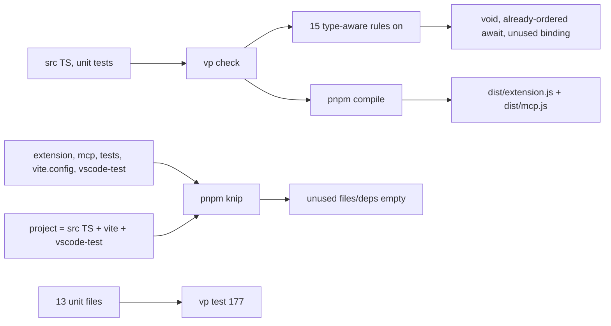
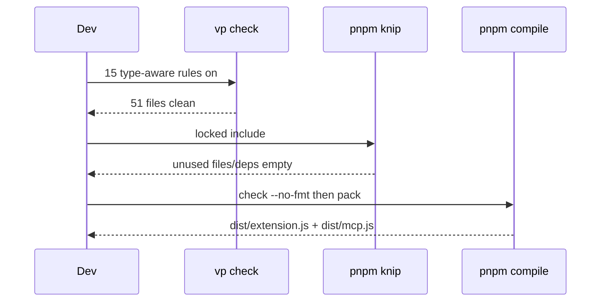

# Stricter static checks - Overview for review

Source of truth: `blueprint/history/features/07e-stricter-static-checks.md`. This file is the steering summary, not the build spec.

## TL;DR

The 15 Oxlint type-aware TypeScript rules 7b held off are on. The only source edit is `_config` in `src/mcp/artboardTools.test.ts`. knip 6.42.1 is a separate unused-file/dep check and exits 0. No product change. No Verify command yet (that is 7h).

## Flow

1. Work sits on `feature/stricter-static-checks`, stacked on 7d (`feature/electron-suite-home` `f5c6500`). `main` is still 7b (`43cce2c`).
2. `vp check` now uses the 15 default-on correctness rules. Host fire-and-forget stays `void`.
3. `pnpm knip` uses the locked `knip.json` (`include` is files/deps only; unused exports stay out).
4. `pnpm compile` is still `vp check --no-fmt && vp pack`. Do not treat a live F5 session as 7e evidence.

## System map

## Key loop

## What you will see

- `vp fmt --check` prints **on 62 files** (`knip.json` joined the set). `vp check --no-fmt` stays **in 51 files**.
- `vp test` still prints **177 passed** (or 175 + 2 skipped if the process uid is 0).
- `pnpm knip` exits 0. First run named `@vscode/test-electron`; that package stays installed and is ignored. Config hints only.
- `pnpm compile` still writes `dist/extension.js` and `dist/mcp.js`.
- `knip.json` is listed in `.vscodeignore`. AGENTS.md has a Knip bullet. The coding-standards lint line names knip as a separate check.
- Electron mocha home from 7d is untouched. No Verify command.

## Data flow

Developer runs `vp check` with the 15 rules on, then `pnpm knip` against the locked project/entries. Compile still packs both entries. The unit lock does not move.

## Architecture decisions

- Rules turn on by deleting the 15 `'off'` keys. They are default-on correctness errors. Options stay type-aware + type-check. `src/test` stays lint-ignored.
- knip is its own `pnpm knip` script. It is not inside `vp check`, compile, or Verify. Do not run `knip --fix`.
- knip looks only at unused files/deps (plus unlisted/binaries/unresolved). Unused exports are out of the report so `src/disk/layout.ts` path constants stay exported.
- `@vscode/test-electron` stays because the 7d Electron runner needs it. The entry imports `@vscode/test-cli`, so knip ignores the electron package after the first-run false positive.

## Decisions locked

- Branch from 7d (`f5c6500`), not from `main` (`43cce2c`).
- `void` = fire-and-forget as today. `await` = caller already sequences. A new `await` on a host command path is refused.
- knip 6.42.1. Locked JSON plus `@vscode/test-electron` on `ignoreDependencies`. Keep `@types/mocha`, `@vscode/test-cli`, `@vscode/test-electron`, and `@types/vscode`.
- Check baseline: fmt **on 62 files**, lint **in 51 files**. Unit lock stays the 7d lock.
- No F5 or `.vsix` proof required for 7e. No Verify command.

## Out of scope

fast-check / snapshots / coverage (7f), MCP contract tests (7g), Verify + CI (7h), product behavior, extra lint rules, folding knip into compile or F5, deleting `src/` files or unused exports to silence knip, `knip --fix`.

## Glossary

| Term | Why it exists |
|---|---|
| Type-aware rules | Oxlint rules that need types. 7b enabled the engine and held the 15 rules off. |
| Pure fix | `void`, an `await` the caller already needed, an unused binding, or a type-only edit. No timing change. |
| knip | Unused files and dependencies. Separate from `vp check`. Unused exports are out of this feature. |
| 7d Electron home | mocha sample still compiles via `tsconfig.test.json` to `out/test/`. Leave it. |

## Done means

The 15 rules are on; knip is clean with the locked include; fmt 62 / lint 51 / tests 177 still hold; `pnpm compile` still writes both `dist/` files; no product behavior change.
