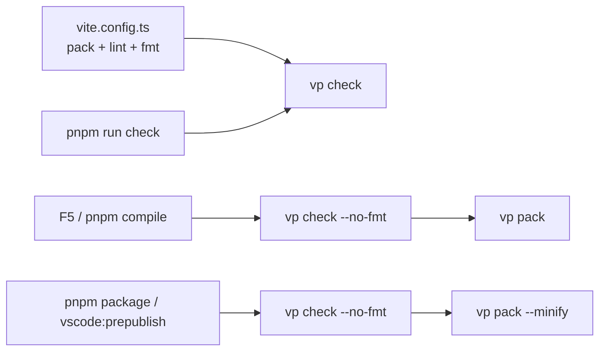

# vp check (7b) - Overview for review

Source of truth: `blueprint/history/features/07b-vp-check.md`. This file is the steering summary, not the build spec.

## TL;DR

`vp check` is now the one static-check command: format, lint, and type check, configured in
`vite.config.ts`. The old `check-types`, `lint`, `fmt`, and `watch:tsc` scripts are gone, along with
`pretest`, the rc files, and the direct oxlint / oxfmt deps. F5 is still gated by lint and types,
never by formatting. No product behavior changed.

## System map

## What you will see

- `pnpm run check` checks formatting on 60 files and lint + types on 52 files.
- `pnpm exec vp check --fix` applies format and lint fixes.
- No `.oxlintrc.json` / `.oxfmtrc.json` in the repo root.
- `main` gets two commits: `style: apply vp fmt` (format only, 15 files), then the feature commit.
- The VS Code `watch` task runs only the pack watcher.

## Decisions locked

- `typeAware` + `typeCheck` are on, so `vp check` type-checks. 15 type-aware `typescript/*` rules
  stay `off` until 7e (`no-floating-promises` would flag about 25 test lines today).
- F5 and packaging skip the format check (`--no-fmt`).
- Lint warnings are still reported without failing the run, as before.
- The lint (52) and format (62) file sets match the old tools exactly. No extra ignores were added.

## Out of scope

Type-aware rules and knip (7e), Vitest (7c), the Electron suite and `out/` build (7d), Verify + CI
(7h), editor settings.

## Glossary

| Term | Why it exists |
|---|---|
| `vp check` | Vite+ command that runs Oxfmt, Oxlint, and the tsgolint type check together |
| tsgolint | Type-aware lint and type check built on TypeScript Go (TS 7) |
| Format drift | Files the formatter would rewrite; committed alone so code review stays readable |

## Your actions

- F5 and the VS Code `watch` task were not run by the agent. You accepted shipping as is.
- F-14 [P2] is still open: the watch task's matcher may never report "ready" because it doesn't
  match `Build complete`. Fix it with a `/fix`.

## Done means

`pnpm run check` is clean, `pnpm compile` writes both `dist/` files, unit tests are 177 / 0, and
the `.vsix` lists the same 9 entries as 7a.
