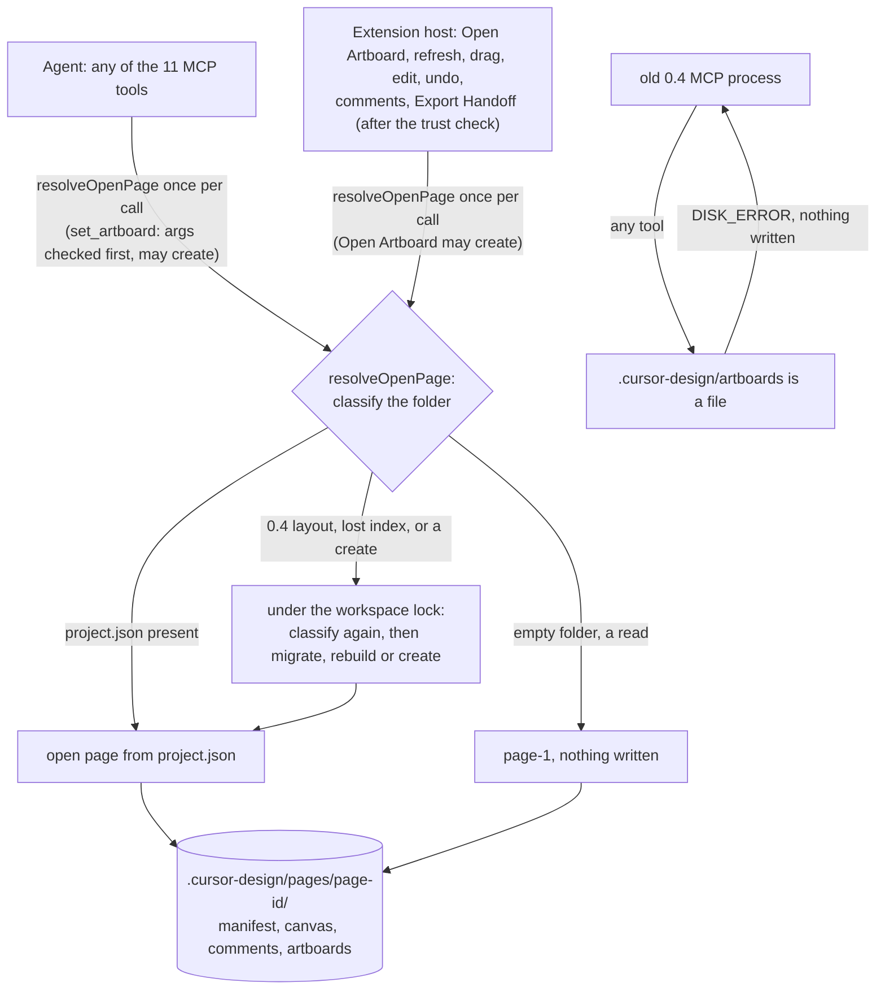
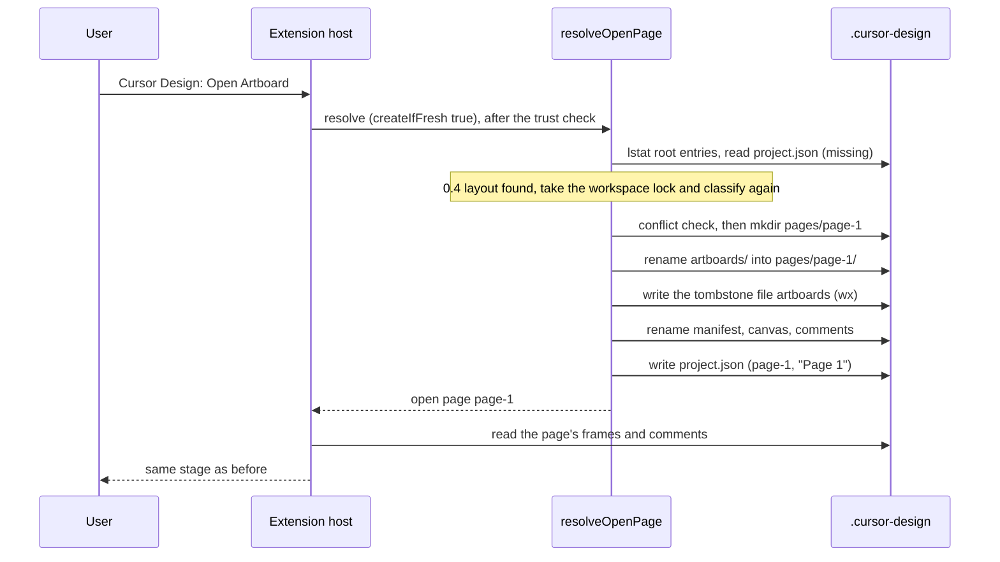

# Pages on disk + migration (10a) - Overview for review

Source of truth: `blueprint/history/features/10a-pages-on-disk-migration.md`. This file is the steering summary, not the build spec.

## TL;DR

The workspace's single design folder now lives as page one of a project on disk: `.cursor-design/project.json` names the open page, and each page's files sit in `.cursor-design/pages/<pageId>/`. Nothing changes in the panel or the Agent's tools. An existing 0.4 folder moves itself the first time anything touches it, and a small `artboards` text file blocks an old 0.4 MCP server that Cursor may still be running. This is the disk base for 10b (page-scoped panel), 10c (page tools), 10d (Pages menu) and 10e (verify).

## What you will see

Nothing new on screen. After the first open with this build:

```txt
.cursor-design/
  project.json              # { version 1, openPageId "page-1", pages [{ id "page-1", title "Page 1" }] }
  pages/page-1/             # manifest.json, canvas.json, comments.json, artboards/ (moved byte for byte)
  artboards                 # small text FILE: "do not delete; quit and reopen Cursor"
  handoff/  tokens.json  assets/  .lock  .ensure-panel   # unchanged, at the root
```

The same frames, comments, flags and handoff status as before. An old 0.4 MCP server now fails every tool with "`.cursor-design/artboards` must be a directory" instead of writing where 0.5 no longer looks.

## System map



## Key loop

The first open of a 0.4 folder:



A crash at any step resumes on the next call to the same result. An entry already present in both places stops with `MIGRATION_CONFLICT` and moves nothing.

## Decisions locked

- **One open page, stored on disk.** Bombic, 2026-11-21, together with the other 0.5 answers: `create_page` opens its page, delete goes to `deleted/`, no `pageId` guard on write tools, migrated title "Page 1".
- **Migration never overwrites.** It moves `artboards/` first, then the tombstone, the JSON files, and finally `project.json`. Unknown root entries (`picking-harness/`) stay where they are.
- **Reads never create a project.** Only a valid `set_artboard` or the panel's first open does. An empty folder reads as today, and `.cursor-design/` is not created.
- **The tombstone guards for good.** It is written wherever `project.json` is first written, and restored if deleted. A root `artboards/` folder next to an index stops with `MIGRATION_CONFLICT`.
- **New codes:** `PAGE_NOT_FOUND`, `CORRUPT_PROJECT`, `UNSUPPORTED_PROJECT_VERSION`, `MIGRATION_CONFLICT`. Panel edit and undo show their generic copy for these, while the panel banner shows the real message.
- **Accepted at audit:** reads can now write (the first move, or restoring a deleted tombstone), so a read-only `.cursor-design/` is not supported (F-08). An index whose open page folder is missing reads as an empty stage; this is carried to 10c (F-09).
- **Unchanged:** file schemas, the one root lock, handoff at the root, read-only tool hints, no new tool, message or UI. Zero new dependencies.

## Out of scope

Page tools and `page` in results (10c), `pageId` on panel messages and per-page chrome state (10b), the Pages menu (10d), the real-Cursor `.vsix` run, README update and downgrade notes (10e).

## Glossary

| Term | Why it exists |
|---|---|
| Page | One whole design (its frames, layout and comments) in its own folder under `pages/` |
| `project.json` | The page index: which pages exist and which one is open |
| Tombstone | A text file at the old `artboards` path so an old 0.4 server fails instead of writing where 0.5 doesn't look |
| Stale 0.4 MCP | Cursor keeps the old MCP server process after an extension update until a full quit and reopen (F-135) |
| Migration | Moving a 0.4 folder's files into `pages/page-1/`, once, resumable |

## Your actions

None required. Opening `fixtures/dev-workspace` with this build migrates it, which is expected. The original 0.4 copy and the 0.4 MCP bundle are kept locally (gitignored) in `fixtures/legacy-0.4-workspace/` for 10e.

## Done means

- 803 unit tests, `pnpm verify` exit 0, browser tests 196 passed.
- Over stdio, the new MCP on a copy of the 0.4 dev folder returns results identical to the 0.4 baseline, field for field. The old 0.4 server fails all 11 tools on migrated and fresh folders and changes nothing.
- Audit (Opus + Sonnet): no P0 or P1; F-01 to F-07 and F-10 closed after a re-audit; F-11 (a P3 host test gap) stays open for 10b.
- Independent review passed on checkpoint `a7af7dc` (fresh Opus 5.5 subagent).
