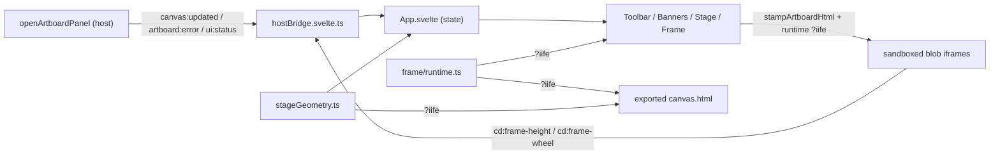
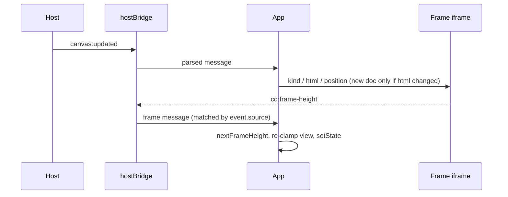

# Svelte port - Overview for review

Source of truth: `blueprint/history/features/08b-svelte-port.md`. This file is the steering summary, not the build spec.

## TL;DR

The artboard panel now runs on Svelte 5 with no behavior change. The template-string chrome is gone. The iframe runtime and the stage geometry are real TS modules, each with one source, shared by the panel and the exported `canvas.html`. `pnpm verify` is green (201 tests, svelte-check 0/0), and the full F5 parity checklist passed on 2026-10-22.

## System map

## Key loop

## What you will see

Nothing new in the panel: same toolbar, banners, frames, labels, zoom, pan, presets and Fit all. Webview DevTools show Svelte-rendered DOM and zero CSP violations.

## Architecture decisions

- **`?iife` plugin** (`scripts/iifeStringPlugin.ts`): imports a TS module as an IIFE string, so script text can be inlined without a hand-written copy. Built with Vite's `build`, unminified, with `</` escaped.
- **Export shares the panel's code**: `canvas.html` embeds the same runtime and geometry, rather than keeping string copies.
- **One host bridge**: only `hostBridge.svelte.ts` posts or listens. Components take props in and send callbacks out.
- **Plain `Map` iframe registry**: matched against `event.source` at message time, registered before `src` is set.
- **No inline styles**: positions use `style:` directives (CSSOM), so the CSP stays unchanged.

## Out of scope

Drag/resize (8c), picking and chrome → frame messages (8d1), selectors (8d2), comments (8e+), any CSP, disk or MCP change, restyling.

## Glossary

| Term | Why it exists |
|---|---|
| IIFE string | A module bundled as one self-running script, so it can be pasted into a document |
| Blob iframe | Each artboard renders from an in-memory URL inside a sandbox, isolated from the chrome |
| Height guard | Stops a `100vh` page from growing forever while it measures itself |
| Parity checklist | The F5 list proving every 0.2 behavior still works |

## Your actions

- Run `/overview` sometime: the project overview body still describes the chrome as a template string.
- Consider a `/fix` for `.vscodeignore`: the `.vsix` currently packs `.remember/**`.

## Done means

Svelte chrome live, old template files deleted, one source each for the runtime and the geometry, `pnpm verify` green, and the F5 parity checklist all passing.
