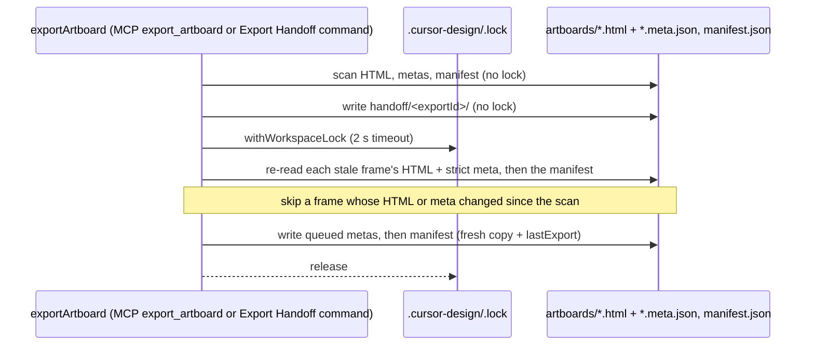

# Fix: Chrome load error and export lock - Overview for review

> **Generated file.** Human-facing steering summary of the active work item:
> same content as `current-feature.md`, trimmed. Written at `/feature` when the
> spec is created, and kept current if the spec is revised. `/complete` may
> polish this into the archive-ready one-pager; it is not the first write.
> Open in Markdown preview to render the diagrams.

Source of truth: `blueprint/history/fixes/chrome-load-error-and-export-lock.md`. This file is the steering summary, not the build spec.

## TL;DR

This fix closes two findings the 9g audit confirmed.
- **F-16:** opening the panel when `dist/webview/chrome.js` or `chrome.css` is missing now shows a Cursor error notification naming the file, instead of a silent blank tab.
- **F-161:** export's final meta refresh and manifest write now run under the workspace lock and re-read the files first, so they no longer overwrite a meta that a panel edit, Undo or Agent update just saved.

## Key loop (export tail, shipped)

## What you will see

- When the chrome bundle is missing, this notification appears: "Cursor Design could not load its panel: dist/webview/chrome.js is missing. Reinstall the extension, or run pnpm compile in a development checkout." Nothing changes when the files exist.
- Exports look the same. A rare `WORKSPACE_BUSY` means retry; the tool description and the Agent skill both say so.

## Decisions locked

- **F-16:**
  - A host-side check reuses `fileExists`, and the shell only exports the asset paths. A fallback text in the shell would flash on every open.
  - Known gap: a `chrome.js` that loads but crashes before mounting still shows a blank panel (`ponytail:`).
- **F-161:**
  - Inside the lock, all reads come before any write.
  - The meta comparison is raw equality with the scan.
  - The manifest race with the unlocked `set_artboard` / `set_active_artboard` is narrowed, not closed (`ponytail:`).

## Evidence

| Check | Result |
|---|---|
| `handoff.test.ts` race cases (a)–(d), plus a test that a corrupt second meta writes nothing | pass; each guard, the lock and the read-before-write order fail their tests when removed |
| `hostFs.test.ts` | pass; the stat-error case fails without the `.catch` |
| Real Cursor, package without `chrome.js` | the toast shows the exact message; the tab stays blank |
| Real Cursor, full package | the `hero` frame renders; no toast within 5 s; the Notifications center is empty |
| `pnpm verify` / `pnpm test:browser` | 742 tests / 168 passed |
| `/audit` (Opus + Sonnet) and closure review | no P0–P2; F-16, F-161 and F-165–F-167 closed; F-168 invalid |

## Glossary

| Term | Why it exists |
|---|---|
| Export tail | The last part of an export, which refreshes stale metas and records `lastExport` |
| Workspace lock | `.cursor-design/.lock`, which keeps the panel and every MCP process from writing at the same moment |
| Chrome bundle | `dist/webview/chrome.js` and `chrome.css`: the panel's UI code |

## Your actions

None.
