# Canvas export - system design

> Architecture of feature **6e**. Spec SoT: [`current-feature.md`](current-feature.md). Steering one-pager: [`current-feature-overview.md`](current-feature-overview.md).
>
> Open this file in **Markdown preview**. Every diagram is Mermaid.

Two entry points. One disk function. One stale rule. Disk is the only source of truth.

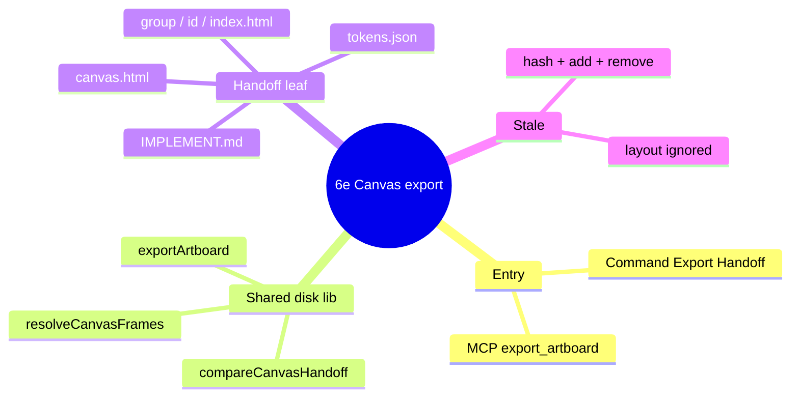

---

## Color key

| Color | Meaning |
|---|---|
| Indigo | Host / command / chrome |
| Violet | MCP process |
| Amber | Disk SoT (read, write, hash) |
| Teal | Pure planners (no fs) |
| Emerald | View-only preview |
| Rose | Fail closed |

---

## 1. Runtime map

Host and MCP are separate processes. Both import `src/disk/`. Chrome never touches disk. `canvas.html` is a file opened in Chrome, not the panel.

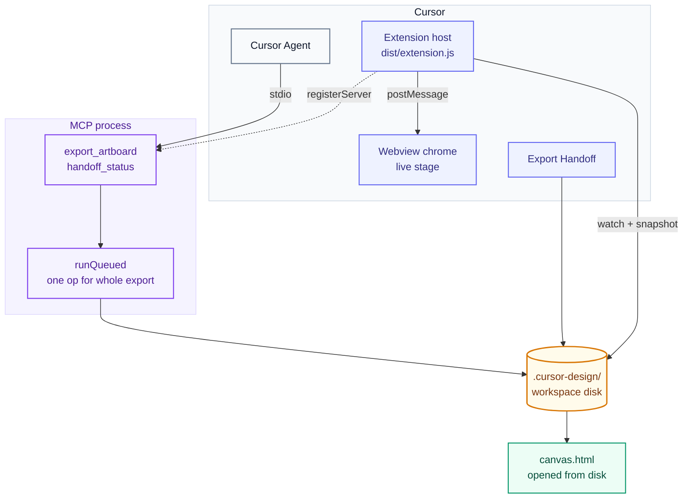

| Who | Owns in 6e | Must not |
|---|---|---|
| **Host** | Command, watcher, badge | Pick the export set, or a second stale rule |
| **MCP** | Tools, one queued disk op | UI, chrome messages |
| **Disk lib** | Scan, plan, write, compare | `vscode.*`, JSON-RPC |
| **Chrome** | Live stage + badge the host posts | Handoff I/O, MCP |
| **`canvas.html`** | Offline layout preview | Be an implement source |

---

## 2. Module graph

Planning is pure. `exportArtboard` is the only writer of a handoff leaf.

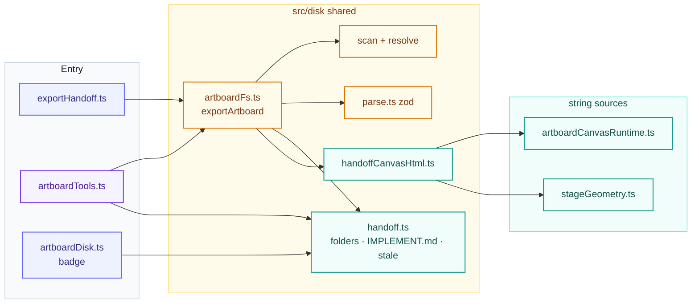

String sources in `src/panel/` stay free of `vscode` and of DOM at module load, so the MCP bundle can import them.

---

## 3. Data model

Height is never stored. Stale never reads `canvas.json`. Manifest version stays **1**; `frames` is additive.

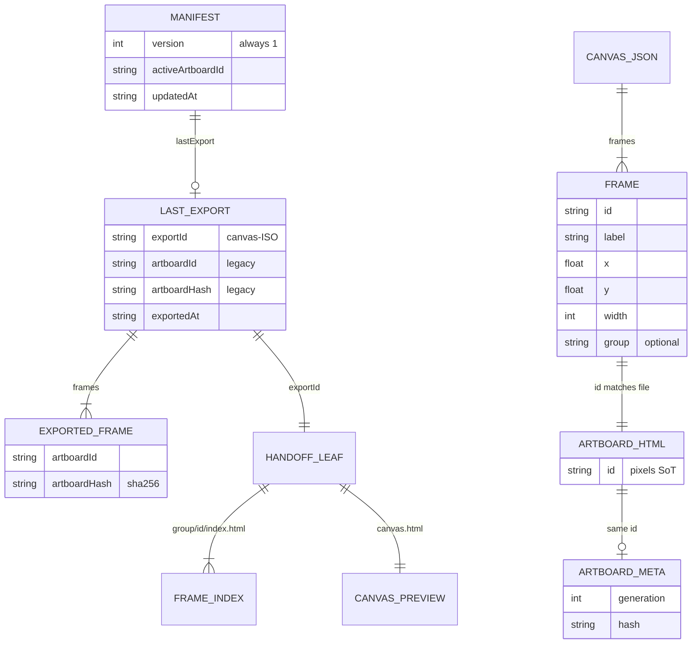

### Workspace tree

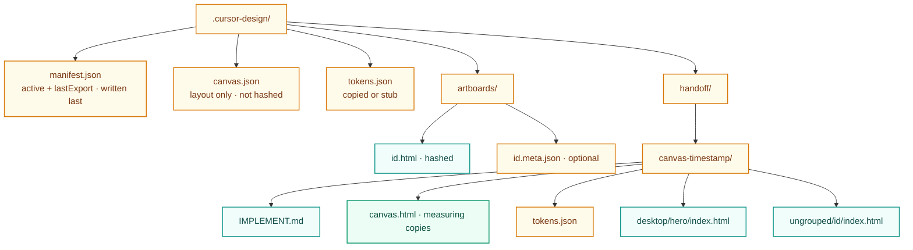

Old handoff leaves are never deleted. Orphan `canvas.json` rows (fixture `t5-mobile`) never reach the tree.

---

## 4. Frame set

Same list `list_artboards` returns. Missing `canvas.json` auto-places every artboard.

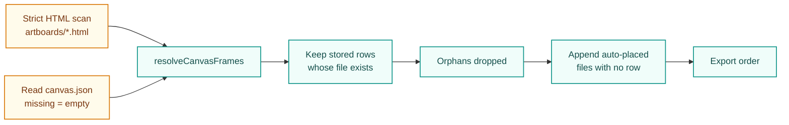

Folder names: lowercase slug of `group`; `ungrouped/` when there is no group (empty string counts as none; whitespace-only is a real group). Collisions take the first free `-2`, `-3`. Ids `.` and `..` refuse to export.

---

## 5. Export pipeline

All-or-nothing **reads**, then writes. MCP wraps the whole thing in one `runQueued`. No `artboardId` input.

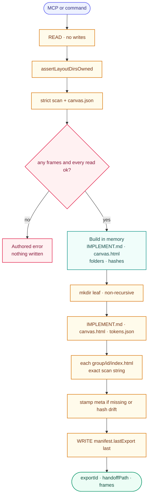

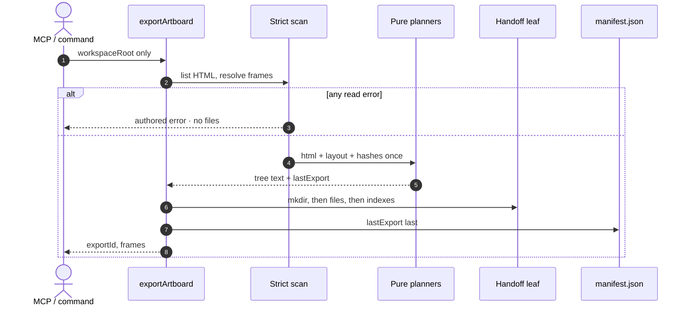

Durability: `lastExport` never points at a leaf whose write failed before the manifest. Mid-tree failure may leave an orphan folder (`ponytail:` no journal). Same-millisecond `mkdir` collision: retry.

---

## 6. Two documents per frame

Pristine lock covers every `index.html`. Only the view-only preview may inject a measuring script.

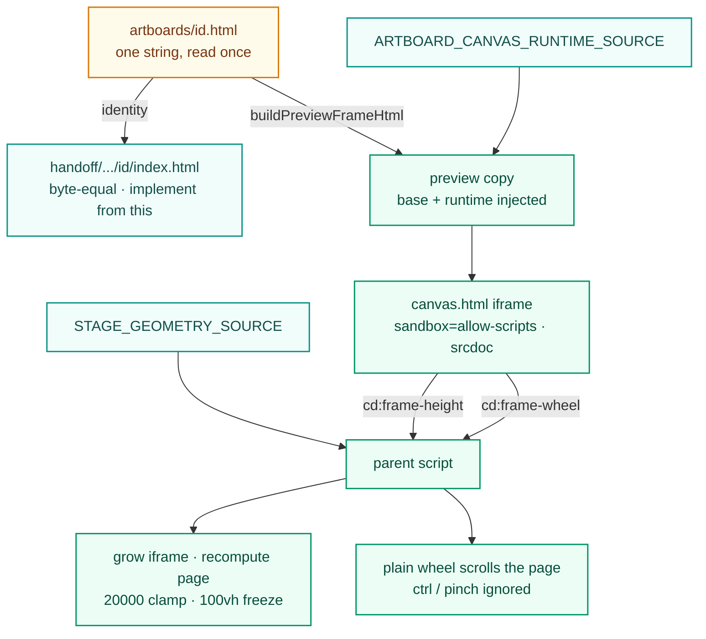

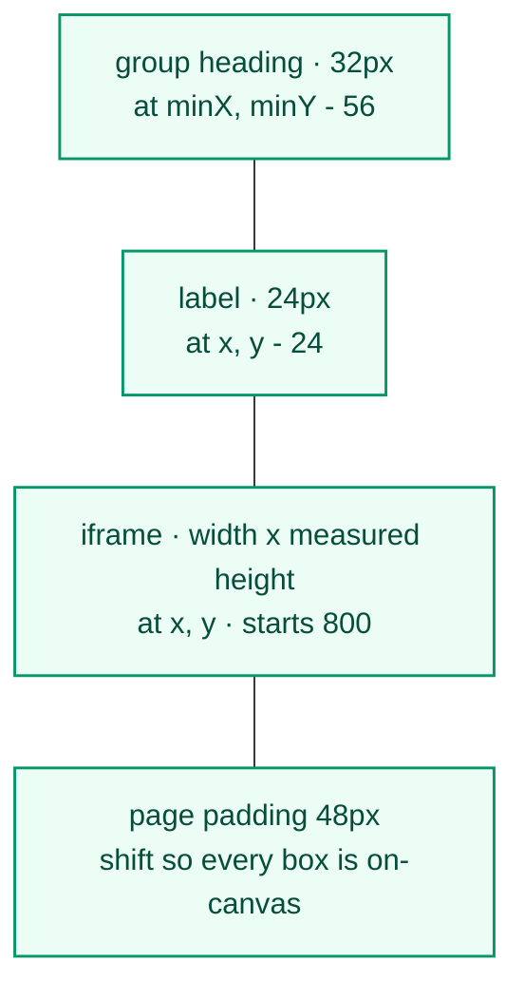

| File | What it is | Audience |
|---|---|---|
| `<group>/<id>/index.html` | Exact disk HTML | Agent implementing |
| `canvas.html` `srcdoc` | Copy + `<base>` + height runtime | Human in Chrome |

`canvas.html` is not the panel: no `--vscode-*`, no pan/zoom, no CSP meta (`srcdoc` inherits parent CSP). Isolation is the iframe sandbox. Parent accepts only allowlisted messages from its own frames' `contentWindow`.

---

## 7. Stale state

One function. Two callers. Same hashes: `hashHtml` of HTML just read, never a stored meta hash. Layout does not count.

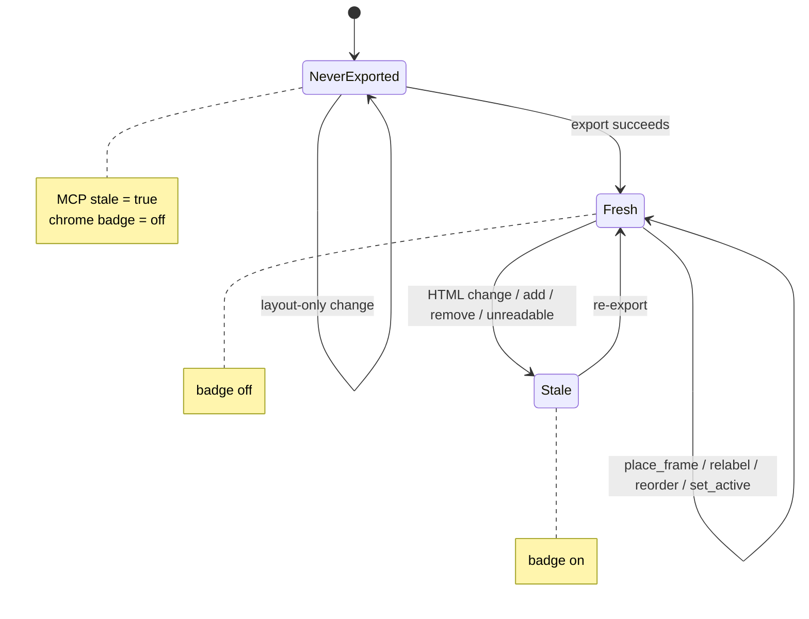

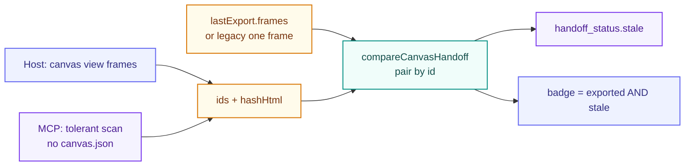

`handoff_status` still requires an active artboard (`activeArtboardId` / `activeHash`). Export itself does not.

---

## 8. Fail closed

Read errors fire before `mkdir`. Authored copy only at the MCP/UI boundary.

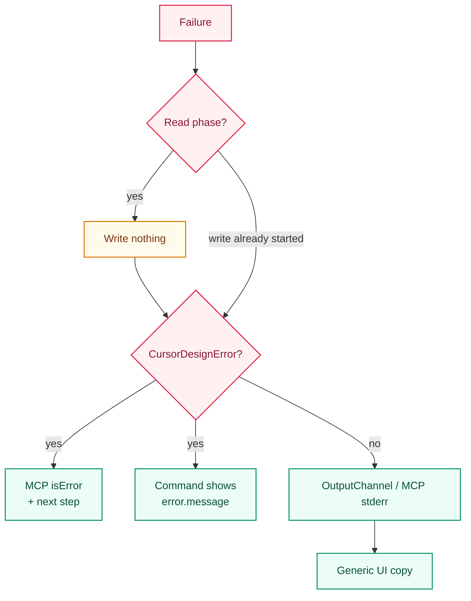

| Code | When |
|---|---|
| `ARTBOARD_NOT_FOUND` | Zero frames (`NoArtboardsToExportError`) |
| `INVALID_ARGS` | MCP passed `artboardId` |
| `CORRUPT_CANVAS` / `CORRUPT_META` | Broken layout or existing meta |
| `DISK_ERROR` | Unreadable HTML, `.` / `..` id, leaf collision |

Labels and groups are Agent text: HTML-escaped in `canvas.html`, newline-collapsed in `IMPLEMENT.md`, never used as paths.

---

## 9. Zod, scoped

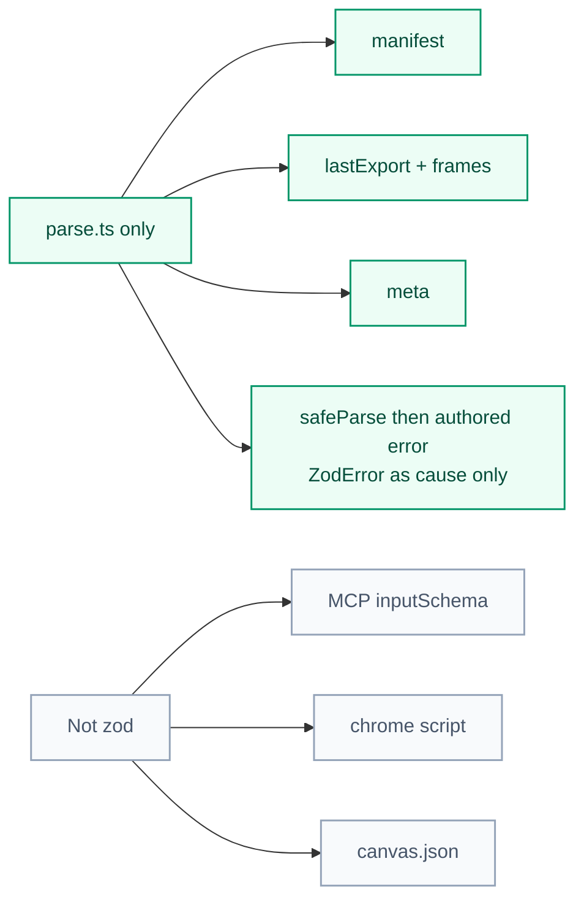

A strict zod MCP schema would replace authored `{ code, message }` with the SDK's generic validation text.

---

## 10. Ceilings and non-goals

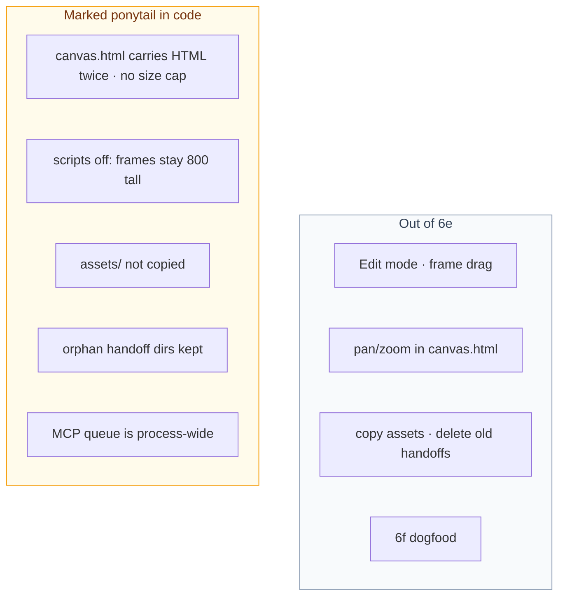

Active artboard still exists for the badge, stage highlight, and `set_active_artboard`. It is no longer the export target.
