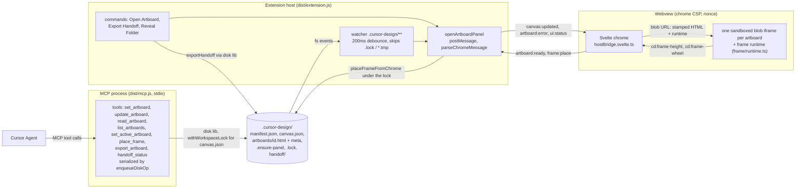
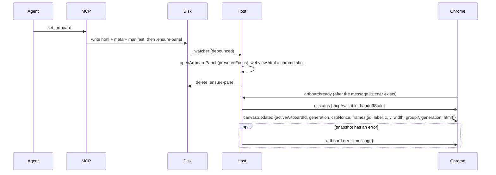
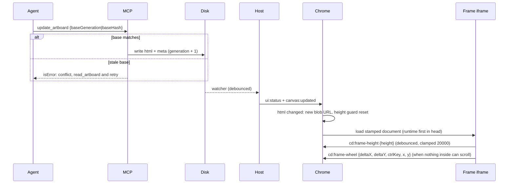
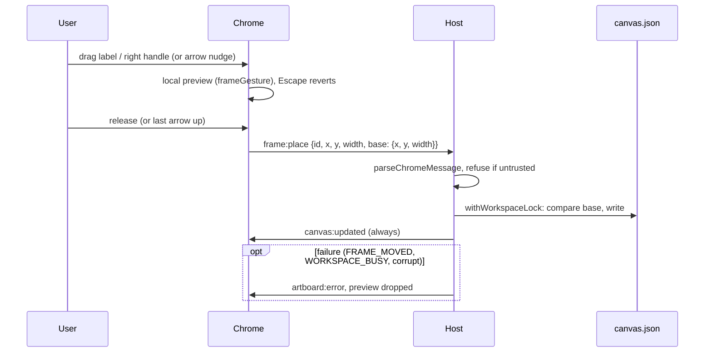

# System map

> **Durable file.** The data flow of the **shipped** code on the default branch: processes,
> messages, and disk. It is for humans steering the project and for agents about to change it.
> `/complete` merges each finished work item's flows in, after checking them against the built
> code. `/feature`, `/fix`, and `/rollback` read it as the baseline and repair any drift they find.
> Planned flows never go here; they live in `current-feature-overview.md` until shipped.
> Open in Markdown preview to render the diagrams.

**Last verified against code:** 8c Frame drag/resize (`c47f25a`).

## Chart checklist

Every chart here and in `current-feature-overview.md` must pass all of these before it is written.
A chart that only looks plausible is wrong.

1. **Trace, don't recall.** Follow each user or Agent action end to end through the source of
   truth: the code for this map, the spec's Data / contracts for a planned overview. Note where the
   event is actually handled (which process or document has it, given focus and event routing),
   what state changes, and what the user sees.
2. **One arrow = one real message or call.** Use the exact wire name (`canvas:updated`, `cd:pick`)
   or function, the real sender and receiver, and the payload fields with their nullability as the
   contract states them.
3. **Complete in both directions.**
   - Every message the contract defines appears at least once.
   - No arrow exists without a contract line or code behind it.
   - Every participant that sends or receives one is shown.
4. **Include the non-happy paths the contract defines:**
   - startup and reload handshakes;
   - mode or state toggles;
   - messages that are dropped (guards, wrong source, wrong mode);
   - failure replies;
   - the two-instance case (two frames, Agent plus user) when the contract has a rule for it.
5. **Planned vs shipped.** An overview chart is labelled with the feature it plans. This map holds
   only shipped flows.
6. **Re-check after every rewrite.** Any spec revision (`/feature-review-fix`, a user-requested
   change) re-runs this list on the overview chart. The text around a chart must agree with it.

## Runtime map

There is no chrome → frame message in shipped code. Chrome never touches disk or MCP. The MCP
process never touches the panel; it reaches the user only through disk and the watcher.

## Panel open and handshake

- Before `artboard:ready`, the host keeps only the latest snapshot and status, and flushes them on
  ready.
- The panel can also open from the **Open Artboard** command.
- When the panel becomes visible, `reloadVisibleArtboardFromDisk` posts a fresh snapshot.
- In an untrusted workspace the host posts `frames: []` plus the untrusted error, and `ui:status`
  reports `mcpAvailable: false`. No watcher runs and no artboard script loads.

## Agent edit to live frame

Chrome matches every frame message by `event.source` against its registered iframes, then runs it
through `parseFrameMessage`. Anything else from an opaque origin is dropped.

## Frame drag / resize (8c)

An Agent `place_frame` takes the same lock. If it lands mid-drag, the next `canvas:updated`
settles the gesture to disk (the Agent wins).

## Export

`export_artboard` (MCP) and the **Export Handoff** command both call the disk lib.

- They write `handoff/<exportId>/`: `IMPLEMENT.md`, `canvas.html`, `tokens.json`, and
  `<group>/<id>/index.html`.
- They record `lastExport` in `manifest.json`.
- `canvas.html` embeds the frame runtime and a preview controller that accepts only
  `cd:frame-height` and `cd:frame-wheel` from its own frames.
- `handoff_status`, and `ui:status.handoffStale`, compare the current frames with `lastExport`.

## Message contract (shipped)

| Direction | Message | Payload |
|---|---|---|
| chrome → host | `artboard:ready` | none |
| chrome → host | `frame:place` | `{id, x, y, width, base: {x, y, width}}` |
| host → chrome | `canvas:updated` | `{activeArtboardId, generation, cspNonce, frames[]}` |
| host → chrome | `artboard:error` | `{message}` (safe copy) |
| host → chrome | `ui:status` | `{mcpAvailable, handoffStale}` |
| frame → chrome | `cd:frame-height` | `{height}` |
| frame → chrome | `cd:frame-wheel` | `{deltaX, deltaY, ctrlKey, x, y}` (frame-local CSS px) |
| chrome → frame | none | |

Rule 02 is the normative contract. If this table and rule 02 disagree, fix whichever no longer
matches the code.
