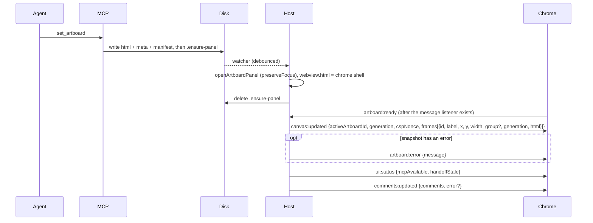
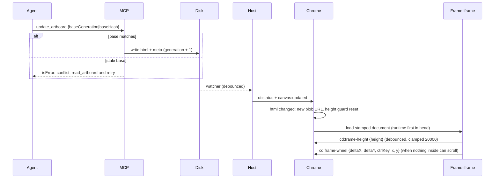
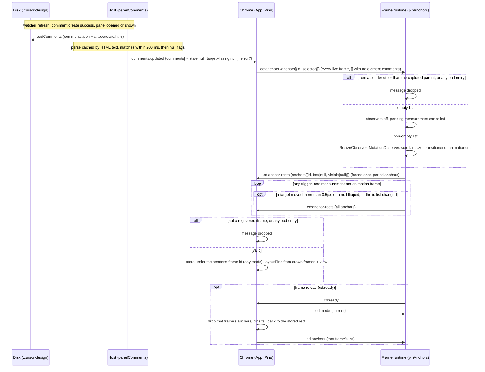
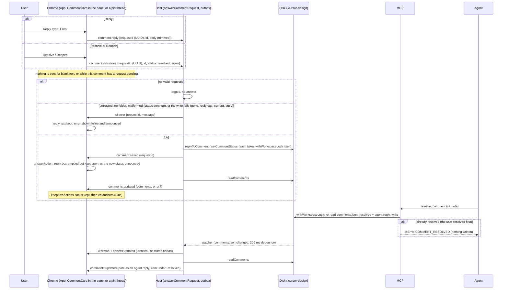
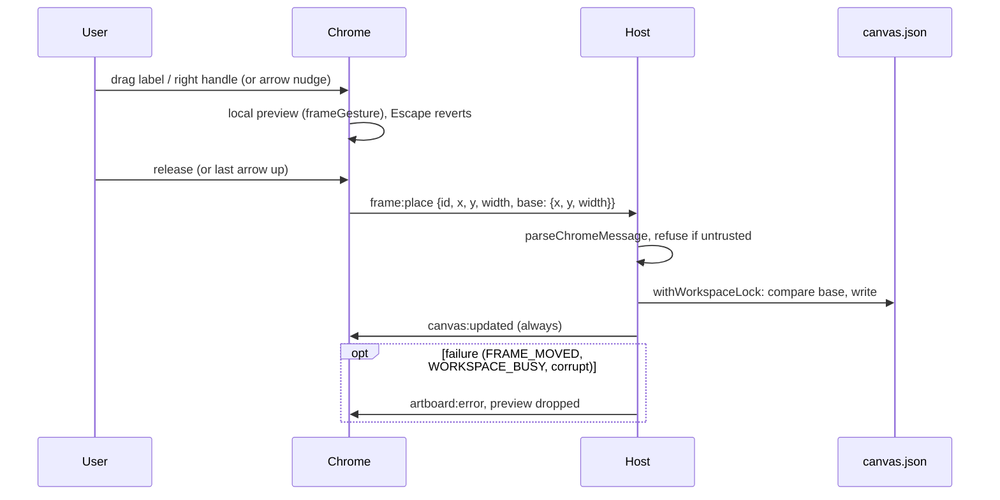

# System map

> **Durable file.** The data flow of the **shipped** code on the default branch: processes,
> messages, and disk. It is for humans steering the project and for agents about to change it.
> `/complete` merges each finished work item's flows in, after checking them against the built
> code. `/feature`, `/fix`, and `/rollback` read it as the baseline and repair any drift they find.
> Planned flows never go here; they live in `current-feature-overview.md` until shipped.
> Open in Markdown preview to render the diagrams.

**Last verified against code:** fix Drop the Electron test suite and css-select (`fix/drop-the-electron-test-suite-and-css-select`): no message or process change; comment flags now match through the in-house `selectMatches` (`selectorMatch.ts`) over parse5's own tree, unchecked past `MAX_MATCH_WORK`. Before it, fix Keep comment drafts across a tab switch (`fix/keep-comment-drafts-across-a-tab-switch`): no host or frame message change; the webview state record gains `commentMode`, `commentDraft`, `openThreadId` and `replyDrafts`. Before it, feature 8i Verify (`feature/verify`): no flow change; docs and agent-run checks only (headless stdio Agent loop, `.vsix` smoke). Before it, fix Pin stacking and zero-count copy (`fix/pin-stacking-and-zero-copy`): no flow change; coinciding pins line up in the chrome, and a 0-count `ui:copied` shows no Copied feedback. Before it, fix Chrome design system (`fix/chrome-design-system`): no flow change; the Parent / Child and Copy labels follow the restyled chrome. Before it, fix Share the copy-type check (`fix/share-the-copy-type-check`): no flow change; `refuse` reuses `isCopyType` for the refresh after every copy `ui:error`. Before it, feature 8h Copy prompt (`feature/copy-prompt`): `comment:copy` / `comment:copy-open` answered once by `ui:copied` or `ui:error`, the host clipboard written before `markCommentsSent`, a `comments:updated` refresh after every copy answer, and one copy at a time in the chrome.

## Chart checklist

Every chart here and in `current-feature-overview.md` must pass all of these before it is written.
A chart that only looks plausible is wrong.

1. **Trace, don't recall.** Follow each user or Agent action end to end through the source of
   truth: the code for this map, the spec's Data / contracts for a planned overview. Note where the
   event is actually handled (which process or document has it, given focus and event routing),
   what state changes, and what the user sees.
2. **One arrow = one real message or call.** Use the exact wire name (`canvas:updated`, `cd:pick`)
   or function, the real sender and receiver, and the payload fields with their nullability as the
   contract states them.
3. **Complete in both directions.**
   - Every message the contract defines appears at least once.
   - No arrow exists without a contract line or code behind it.
   - Every participant that sends or receives one is shown.
4. **Include the non-happy paths the contract defines:**
   - startup and reload handshakes;
   - mode or state toggles;
   - messages that are dropped (guards, wrong source, wrong mode);
   - failure replies;
   - the two-instance case (two frames, Agent plus user) when the contract has a rule for it.
5. **Planned vs shipped.** An overview chart is labelled with the feature it plans. This map holds
   only shipped flows.
6. **Re-check after every rewrite.** Any spec revision (`/feature-review-fix`, a user-requested
   change) re-runs this list on the overview chart. The text around a chart must agree with it.

## Runtime map

```mermaid
flowchart LR
  Agent["Cursor Agent"]
  subgraph MCP["MCP process (dist/mcp.js, stdio)"]
    Tools["tools: set_artboard, update_artboard, read_artboard,<br/>list_artboards, set_active_artboard, place_frame,<br/>export_artboard, handoff_status,<br/>list_comments, get_comment, resolve_comment<br/>serialized by enqueueDiskOp"]
  end
  subgraph Host["Extension host (dist/extension.js)"]
    Watcher["watcher .cursor-design/**<br/>200ms debounce, skips .lock / *.tmp"]
    Panel["openArtboardPanel + panelComments<br/>postMessage, parseChromeMessage"]
    Cmds["commands: Open Artboard,<br/>Export Handoff, Reveal Folder"]
    Skill["syncAgentSkill on activate (Cursor only)"]
  end
  subgraph Webview["Webview (chrome CSP, nonce)"]
    Chrome["Svelte chrome<br/>hostBridge.svelte.ts"]
    Frames["one sandboxed blob iframe per artboard<br/>head: charset, FRAME_CSP, runtime (frame/runtime.ts)"]
  end
  Disk[(".cursor-design/<br/>manifest.json, canvas.json, comments.json,<br/>artboards/id.html + meta,<br/>.ensure-panel, .lock, handoff/")]
  Home[("~/.cursor/skills/cursor-design/SKILL.md")]
  State[("webview state<br/>stageView, commentsPanelOpen,<br/>commentMode, commentDraft, openThreadId, replyDrafts")]
  Clip[("system clipboard")]

  Agent -->|MCP tool calls| Tools
  Tools -->|disk lib, withWorkspaceLock for canvas.json and comments.json| Disk
  Skill -->|copy shipped skills/cursor-design/SKILL.md when bytes differ; never through a symlink| Home
  Disk -->|fs events| Watcher
  Watcher --> Panel
  Cmds --> Panel
  Cmds -->|exportHandoff via disk lib| Disk
  Panel -->|canvas:updated, artboard:error, ui:status,<br/>comments:updated, comment:added, comment:saved, ui:copied, ui:error| Chrome
  Chrome -->|artboard:ready, frame:place, comment:create,<br/>comment:reply, comment:set-status, comment:copy, comment:copy-open| Panel
  Panel -->|placeFrameFromChrome, addComment, replyToComment,<br/>setCommentStatus, markCommentsSent under the lock;<br/>readComments, getComment, listComments| Disk
  Panel -->|vscode.env.clipboard.writeText: the locked Agent prompt (8h)| Clip
  Chrome -->|getState on load (parseSavedCommentUi), setState: each save keeps the other keys| State
  Chrome -->|blob URL: stamped HTML + runtime| Frames
  Frames -->|cd:frame-height, cd:frame-wheel,<br/>cd:ready, cd:hover, cd:pick, cd:key,<br/>cd:anchor-rects| Chrome
  Chrome -->|postToFrame: cd:mode,<br/>cd:pick-parent, cd:pick-child, cd:anchors| Frames
```

Each blob frame's head starts with the artboard's `<meta charset>`, then `FRAME_CSP` (inline
script and style only, no sources), then the runtime: a nonce'd `<script src>`, even one injected
at runtime or by a script placed before `<meta charset>`, never loads. Chrome → frame messages (8d1) go only through `postToFrame`, to registered iframes; the frame
runtime accepts them only from the parent it captured at load. Chrome never touches disk or MCP. The MCP
process never touches the panel; it reaches the user only through disk and the watcher.

## Comments for the Agent (8e)

```mermaid
sequenceDiagram
  participant A as Agent
  participant M as MCP
  participant D as Disk
  participant H as Host
  A->>M: list_comments {status?} / get_comment {id}
  M->>D: read comments.json; artboards/<frameId>.html (parse5, once per frame per call)
  M-->>A: comment + stale, targetMissing, hint? (list: replyCount instead of replies)
  A->>M: update_artboard (existing)
  A->>M: resolve_comment {id, note}
  M->>D: withWorkspaceLock: re-read comments.json, resolved + agent reply, write
  alt resolved / unknown / thread full / corrupt / lock busy
    M-->>A: isError COMMENT_RESOLVED / COMMENT_NOT_FOUND / INVALID_ARGS / CORRUPT_COMMENTS / WORKSPACE_BUSY
  end
  D-->>H: watcher (comments.json changed)
  H->>H: identical canvas:updated, no frame reload
```

- `stale` and `targetMissing` come from disk only (`commentTarget.ts`): the stored selector runs
  through the in-house `selectMatches` (`selectorMatch.ts`: finder grammar only, one linear walk
  with Chromium's matching rules); a selector outside that grammar, or a match past
  `MAX_MATCH_WORK` element-steps, leaves both flags `null`.
- Every flag read (MCP and panel) shares one path: a parse cached per workspace and frame while
  the HTML text is identical (32 frames at most, oldest evicted), and a 200 ms target-check budget
  timed after the parse. Past the budget, a comment that needs a match reports `null` flags and a
  hint to read again.
- The panel reads the same flags (`readComments`, 8f2) and shows a broken file as its own banner;
  nothing on the canvas or export path reads it, so it never blanks the stage.

## Panel open and handshake



- Before `artboard:ready`, the host keeps only the latest snapshot, status and comment list, and
  flushes them on ready in that order (`createPanelOutbox`). A later `artboard:ready` (webview
  reload) re-sends all three; `ui:status` waits until `mcpAvailable` is known. Answers to a chrome
  request (`comment:added`, `comment:saved`, `ui:error`) are posted only while ready and never
  replayed.
- The panel can also open from the **Open Artboard** command.
- When the panel becomes visible, `reloadVisibleArtboardFromDisk` posts a fresh snapshot and
  comment list. Every watcher refresh re-reads the comment list too; the last read started wins.
- In an untrusted workspace the host posts `frames: []` plus the untrusted error, and `ui:status`
  reports `mcpAvailable: false`. No watcher runs and no artboard script loads.

## Agent edit to live frame



Chrome routes every window message with `routeMessage`: a registered iframe's window is a frame
message (then `parseFrameMessage`), any other opaque-origin sender is dropped, the rest goes to
`parseHostMessage`. Each `canvas:updated` is merged by `mergeCanvasFrames`: an identical re-post
(tab switch) changes nothing; new html reloads that frame and restarts its height guard.

Stage pan and zoom have three inputs, all through `wheelToView` / `panStage`: a wheel on the stage
(Stage's non-passive listener), `cd:frame-wheel` from a frame, and the root scroll sink. Chromium
latches a trackpad gesture to the out-of-process frame it started over and, once the frame slides
out from under the pointer, hands the rest to the chrome as native root scroll. The chrome is
`position: fixed` over a body with hidden scroll room, so `CanvasState` turns each root scroll into a pan and
scrolls back (`scrollSinkStep`), but only within a second of a frame wheel or an earlier sink pan.

## Comment-mode picking (8d1)

```mermaid
sequenceDiagram
  participant U as User
  participant C as Chrome (App + commentPick)
  participant A as Frame A runtime
  participant B as Frame B runtime
  A->>C: cd:ready (load or reload)
  C->>C: clear A's hover/pick
  C->>A: cd:mode {current mode}
  U->>C: Comment toggle
  C->>A: cd:mode {comment}
  C->>B: cd:mode {comment}
  U->>A: pointer move
  A->>C: cd:hover {rect|null} (once per animation frame, on change)
  U->>A: click (picked, then blocked; frame takes focus)
  A->>C: cd:pick {selector|null, tagName, text, rect|null, point, box, styles, isPage, repost}
  U->>A: ↑ / ↓ (focus in frame)
  A->>C: cd:pick (parent / child)
  U->>C: parent / child icon buttons, or ↑/↓ with chrome focus
  C->>A: cd:pick-parent / cd:pick-child
  A->>C: cd:pick
  U->>B: click in frame B
  B->>C: cd:pick
  C->>A: cd:mode {comment} (A forgets its path)
```

- Chrome ignores `cd:hover` and `cd:pick` outside Comment mode; a design's own script can post them.
- Only iframe frames hold a pick: a frame that becomes a tile or leaves the stage drops it; an
  empty stage leaves Comment mode.
- Frame data reaches the UI only as chip text and outline geometry (never `{@html}`).

## Comment mode and popover (8f1)

```mermaid
sequenceDiagram
  participant U as User
  participant C as Chrome (App, CommentPopover)
  participant F as Frame runtime
  participant H as Host (panelComments, outbox)
  participant D as Disk (.cursor-design)
  alt key with chrome focus
    U->>C: c / Escape
  else key with frame focus (not editable, no Ctrl/Meta/Alt, no repeat)
    U->>F: c / Escape
    F->>C: cd:key {key: 'c' | 'Escape'}
    Note over C: ignored while the popover is open
  end
  C->>F: cd:mode {comment | interact} (every live frame)
  U->>F: click (blocked, picked)
  F->>C: cd:pick {..., box, repost: false}
  C->>C: open or retarget the popover, focus the box next frame
  F->>C: cd:pick {..., repost: true} (scroll / resize)
  Note over C: moves the open draft only; never opens one
  U->>C: ↑ / ↓ (box empty, focus in popover)
  C->>F: cd:pick-parent / cd:pick-child
  F->>C: cd:pick {repost: false}
  U->>C: Enter (box has text)
  C->>H: comment:create {requestId (UUID), frameId, generation, pick fields, body}
  alt no valid requestId
    H->>H: logged, no answer
  else untrusted, no folder, malformed, or addComment fails (PICK_OUTDATED, busy, corrupt)
    H->>C: ui:error {requestId, message} (text kept)
  else ok
    H->>D: addComment under withWorkspaceLock
    H->>C: comment:added {requestId}
    C->>F: cd:mode {comment} (pick cleared, popover closed)
    H->>D: readComments
    H->>C: comments:updated {comments}
  end
  U->>C: Escape in popover (mode stays)
  C->>F: cd:mode {comment} (pick cleared, focus to frame)
  U->>F: Escape again
  F->>C: cd:key {Escape}
  C->>F: cd:mode {interact}
```

- An answer whose `requestId` is not the pending one is ignored; Cancel is disabled while a save
  is pending. Toggling the mode drops the draft, so a late answer finds nothing.
- An Agent edit reloads the frame and drops the pick; the popover keeps its text and greys out
  the parent and child buttons, and the next Add gets "Pick it again" (`PICK_OUTDATED`).
- A forged `cd:key` from a design script cannot discard a draft. A forged user `cd:pick` can
  retarget it; the text is kept and the chip changes.
- After Add, the new comment's pin arrives with that `comments:updated` (8f2, next section).

## Pins (8f2)



- A pin is placed only for a comment on a live iframe frame. Frame-local point: a page comment is
  its fraction of the frame record; an element comment is its fraction of the live `box`, or of
  the stored `rect` until the frame answers or when `box` is `null`.
- A pin is hidden when the live `box` exists and `visible` is `null` or the point is outside it,
  and when the point is outside the frame. A forged `cd:anchor-rects` only moves or hides that
  frame's own pins: it is stored under the sender's id and never draws over a neighbor frame.
- Badge (`pinBadge`): none for a resolved comment, else `missing` (live `box: null` or
  `targetMissing: true`), else `stale`, else `unchecked` (both flags `null`).
- `cd:anchors` is ignored by `commentPicking`, so it never steps an open pick. The pin layer is
  `inert` while a draft is open, so a click there picks the element under it.
- A pin click opens `CommentThread` with no message to the host. Escape or Close returns focus to
  the pin. The thread closes when its comment or pin goes away, or a draft opens; focus inside it
  then moves to the stage viewport. One `$effect.pre` in `PinThread` closes it whenever `pins` no longer
  holds it, before it unmounts, so it never stays open while hidden.

## Comments panel (8g)



- `openArtboardPanel` hands every message that claims `comment:create`, `comment:reply` or
  `comment:set-status` (`commentRequestType`, read before any parse) to `answerCommentRequest`,
  valid or not. It checks the `requestId`, trust, the folder, then a parse whose type must match
  the claim, then writes. `comment:create` takes the same handler and is unchanged on the wire
  (answered by `comment:added`, 8f1).
- The answer is posted before `postPanelComments`, so `comment:saved` arrives before the
  `comments:updated` it causes; a failure posts no refresh. A deleted comment reads "This comment
  no longer exists." (`commentRequestErrorMessage`), never the Agent copy.
- A user Resolve after the Agent's is a no-op that writes nothing and still answers
  `comment:saved`. A reply keeps the status. The host's own write also fires the watcher, which
  posts the same snapshot and list again.
- Chrome: one request in flight per comment, matched only by `requestId`. A `ui:error` is offered
  to both the draft (8f1) and the actions; UUIDs never cross-match. A `comments:updated` without
  `error` drops actions for comments no longer listed; one with `error` keeps them, so typed text
  survives a failed read. A webview reload resets the actions (a lost answer leaves `pending` set
  until then, `ponytail:`).
- The panel and the pin thread render the same `CommentCard`, and actions are keyed by comment
  id, so a reply box open in one is open in the other with the same text. The panel is always
  mounted and renders its list only while open. When an update rebuilds the focused item and focus
  fell to body, it goes back to the same control, but only while the webview has focus.
- Panel state: the toolbar toggle saves `commentsPanelOpen` (`saveCommentsPanelOpen`) in the one
  webview state record beside `stageView`; each save keeps the other keys. A missing or
  non-boolean value reads as closed. Nothing new on disk.
- Comment UI across a tab switch (fix, chrome-only): one `$effect` saves `commentMode`,
  `commentDraft` (with its `body`; never a pending one), `openThreadId` and `replyDrafts` through
  `saveCommentUi`, omitting default keys. On load `parseSavedCommentUi` drops bad keys one by one.
  Comment mode and reply text come back at once; the draft is held until the first
  `canvas:updated` (`resolveHeldDraft`: back on a live iframe frame, else dropped), the thread
  until its pin is placed (`resolveHeldThread`). A restored item takes focus only when nothing else
  has it. No message to the host.
- Click to jump is chrome-only, with no message to the host or a frame. The target chip of a
  comment on a live iframe frame runs `jumpTarget` from the frame's latest `cd:anchor-rects` (else
  the stored rect), then `jumpStageView` (keeps the zoom, zooms out only to fit) through
  `commitStageView`, which clamps and saves `stageView`. `Overlay` draws the `data-cd-flash`
  outline for `JUMP_FLASH_MS` (1.5 s), following pan, zoom and later `cd:anchor-rects`. Nothing
  scrolls inside the frame.

## Copy for Agent (8h)

```mermaid
sequenceDiagram
  participant U as User
  participant C as Chrome (App + commentsPanel.ts rules, CommentCard / CommentsPanel)
  participant H as Host (answerCommentRequest)
  participant CB as vscode.env.clipboard
  participant D as Disk (comments.json)
  participant A as Agent chat
  U->>C: Copy for Agent (panel card or pin thread) / Copy N open comments for Agent
  alt any copy pending (copyPending), anything pending on that comment, or N = 0
    C->>C: nothing posted (button aria-disabled)
  else
    C->>H: comment:copy {requestId (UUID), id} / comment:copy-open {requestId}
    alt no valid requestId
      H->>H: logged, no answer
    else untrusted, no folder, malformed, gone id, zero open, clipboard rejects
      H->>C: ui:error {requestId, message}
      H->>C: comments:updated (refresh)
    else
      H->>D: getComment / listComments {status: open} (no lock)
      H->>CB: await writeText(singleCommentPrompt / openCommentsPrompt)
      H->>D: markCommentsSent(ids) (takes withWorkspaceLock; open → sent only)
      alt mark throws (busy, corrupt)
        H->>C: ui:error {requestId, COPIED_NOT_MARKED}
        H->>C: comments:updated (refresh)
      else
        H->>C: ui:copied {requestId, count}
        H->>D: readComments
        H->>C: comments:updated
        D-->>H: watcher (only when a comment changed): ui:status + canvas:updated (identical) + comments:updated
      end
    end
    C->>C: answerAction / answerCopyOpen: "Copied" (or "Copied N comments") for 1.5 s, announcement, or the error linked to its button
  end
  U->>A: paste the prompt by hand
```

- The prompt is built in the host from disk (`commentPrompt.ts`): artboard, version and styles
  never reach the chrome. Both templates are locked word for word and pinned by a literal test.
  Frame-sourced fields (`artboard`, `selector`, `text`) pass `toOneLine` (control, format and
  white-space runs become one space, capped, no lone surrogate); `{text}` also loses its `"`. The
  body keeps its newlines (the user's own text, `ponytail:`).
- The clipboard is written before `markCommentsSent`, so a rejected write marks nothing sent.
  `count` is how many comments moved open → sent: 0 for a re-copy, or when the Agent resolved them
  first (they stay resolved). `markCommentsSent` writes nothing when nothing changed, so a re-copy
  fires no watcher.
- Copy N open comments for Agent lists the open ids in `comments.json` (creation) order. Zero open answers
  "There are no open comments to copy." with no clipboard write. Every copy answer, success or
  failure, is followed by a `comments:updated`, so a stale N corrects itself.
- Chrome: one copy at a time across the panel and threads (`copyPending`), so the clipboard holds
  the prompt of the last answered copy. `ui:copied` matches only a pending copy and never touches a
  reply draft. `comments:updated` never clears the batch's pending request. A lost answer keeps
  every Copy button blocked until a webview reload (the 8g `ponytail:`).

## Frame drag / resize (8c)



An Agent `place_frame` takes the same lock. If it lands mid-drag, the next `canvas:updated`
settles the gesture to disk (the Agent wins).

## Export

`export_artboard` (MCP) and the **Export Handoff** command both call the disk lib.

- They write `handoff/<exportId>/`: `IMPLEMENT.md`, `canvas.html`, `tokens.json`, and
  `<group>/<id>/index.html`.
- They record `lastExport` in `manifest.json`.
- `canvas.html` embeds the frame runtime and a preview controller that accepts only
  `cd:frame-height` and `cd:frame-wheel` from its own frames. It never sends `cd:anchors`, so the
  runtime's pin observers stay off there.
- `handoff_status`, and `ui:status.handoffStale`, compare the current frames with `lastExport`.

## Message contract (shipped)

| Direction | Message | Payload |
|---|---|---|
| chrome → host | `artboard:ready` | none |
| chrome → host | `frame:place` | `{id, x, y, width, base: {x, y, width}}` |
| chrome → host | `comment:create` | `{requestId, frameId, generation, selector, tagName, text, rect \| null, point, box, styles, isPage, body}` |
| chrome → host | `comment:reply` | `{requestId, id, body}` |
| chrome → host | `comment:set-status` | `{requestId, id, status: 'open' \| 'resolved'}` |
| chrome → host | `comment:copy` | `{requestId, id}` (8h) |
| chrome → host | `comment:copy-open` | `{requestId}` (8h) |
| host → chrome | `canvas:updated` | `{activeArtboardId, generation, cspNonce, frames[]}` |
| host → chrome | `artboard:error` | `{message}` (safe copy) |
| host → chrome | `ui:status` | `{mcpAvailable, handoffStale}` |
| host → chrome | `comments:updated` | `{comments[], error?}` (each comment has `stale` and `targetMissing`, `true`, `false` or `null` = unchecked) |
| host → chrome | `comment:added` | `{requestId}` |
| host → chrome | `comment:saved` | `{requestId}` (answer to `comment:reply` / `comment:set-status`, posted before the `comments:updated` it causes) |
| host → chrome | `ui:copied` | `{requestId, count}` (answer to `comment:copy` / `comment:copy-open`; `count` = comments moved open → sent; posted before the `comments:updated` it causes) |
| host → chrome | `ui:error` | `{message, requestId?}` (safe copy) |
| frame → chrome | `cd:frame-height` | `{height}` |
| frame → chrome | `cd:frame-wheel` | `{deltaX, deltaY, ctrlKey, x, y}` (frame-local CSS px) |
| frame → chrome | `cd:ready` | none |
| frame → chrome | `cd:hover` | `{rect \| null}` (frame-local CSS px) |
| frame → chrome | `cd:pick` | `{selector \| null, tagName, text, rect \| null, point, box, styles, isPage, repost}` (selector from finder inside the frame; `point` relative to the target's box, `box` its unclipped size; `repost` true for a scroll or resize re-post) |
| frame → chrome | `cd:key` | `{key: 'c' \| 'Escape'}` (frame focus, not editable, no modifiers or repeat) |
| frame → chrome | `cd:anchor-rects` | `{anchors: [{id, box \| null, visible \| null}]}` (frame-local CSS px; `box` unclipped, `visible` clipped by scrolling ancestors and the frame viewport; `box: null` requires `visible: null`) |
| chrome → frame | `cd:mode` | `{mode: 'interact' \| 'comment'}` |
| chrome → frame | `cd:pick-parent`, `cd:pick-child` | none |
| chrome → frame | `cd:anchors` | `{anchors: [{id, selector}]}` (the frame's element comments, every status; replaces its previous list) |

Rule 02 is the normative contract. If this table and rule 02 disagree, fix whichever no longer
matches the code.
