# System map

> **Durable file.** The data flow of the **shipped** code on the default branch: processes,
> messages, and disk. It is for humans steering the project and for agents about to change it.
> `/complete` merges each finished work item's flows in, after checking them against the built
> code. `/feature` and `/fix` read it as the baseline and repair any drift they find.
> Planned flows never go here; they live in `current-feature-overview.md` until shipped.
> Open in Markdown preview to render the diagrams.

**Last verified against code:** 2026-11-23, fix Lean export and helper sweep (`fix/lean-export-and-helper-sweep`): no message, disk format or process flow change; Verify runs `knip` and `knip --production`, test-only exports are un-exported or tagged `@internal`, `isFiniteNumber` / `isRecord` live once in `frameMessages.ts`, `PROVISIONAL_FRAME_HEIGHT` once in `stageGeometry.ts` (the `canvas.html` stageGeometry iife gains it), and the `artboardFs.ts` / `artboardDisk.ts` re-exports are gone. Before it, 2026-11-23, fix Page test gaps and parallel browser tests (`fix/page-test-gaps-and-parallel-browser-tests`): no message, disk format or process flow change; the chrome drops the staged page's `canvas:updated` / `comments:updated` after mount (same page, no remount), and the browser tests split into `parallel` and `serial` Playwright projects. Before it, 2026-11-22, feature 10b Page-scoped panel (`feature/page-scoped-panel`): `canvas:updated` and `comments:updated` carry `pageId` (`''` = no page resolved), and the 8 page-bound chrome → host requests (`frame:place`, `artboard:edit`, `artboard:history`, the 5 comment requests) carry a `pageId` that passes `isPageId`; the host acts on that page through `resolveRequestedPage` (answer `That page no longer exists.` when it is gone), undo history is keyed by page and frame, and the chrome splits into `App.svelte` (host bridge, state that spans pages) and a per-page `DesignPage.svelte` under `{#key}` on the stage page id (new section Page-scoped panel (10b)). No disk format, MCP or skill change. Before it, feature 10a Pages on disk + migration (`feature/pages-on-disk-migration`): no message change. Disk format: the per-page files (`manifest.json`, `canvas.json`, `comments.json`, `artboards/`) move byte for byte into `.cursor-design/pages/<pageId>/`, a new root `project.json` (version 1: `openPageId`, `pages`) names the open page, and root `artboards` becomes a tombstone file that makes a still-running 0.4 MCP fail with `DISK_ERROR`; handoffs, `tokens.json`, `assets/`, `.lock` and `.ensure-panel` stay at the root, and `lastExport` is recorded in the page's manifest. Flows: every MCP tool and host entry point calls `resolveOpenPage` once per call (new section Open page and migration (10a): classify, resumable migration, index rebuild, fresh create only for `set_artboard` and Open Artboard), and the Runtime map, comment, pin, drag and Export charts name the page paths. Before it, fix System map charts parse (`fix/system-map-charts-parse`): no message, disk format or process flow change; the 8 charts that failed `mermaid.parse` now parse (`;` in sequence text → `,` or `.`, quoted Runtime map edge labels), and the Chart checklist gains item 7. Before it, feature 9i Inspector redesign (`feature/inspector-redesign`): the chrome becomes the first multi-change `artboard:edit {styles}` sender (a choice is one change, a section Reset or Add border several, through `handleStyleChanges` → `stylesCommit`: one preview, one write, one undo step); a new draft or a choice first ends the element's other open drafts (valid ones save, invalid ones end silently), and `cd:pick-refresh` now goes out when focus enters any inspector control. No message, disk or host change. Before it, feature 9h More edit fields: saving (`feature/more-edit-fields-saving`): `artboard:edit` becomes text `{field: 'text', value, liveText}` or styles `{styles: StyleChange[]}` (1..19 distinct `EDIT_STYLE_FIELDS`, one write and one undo step; the field inspector sends one change), and the edit core and the chrome preview share `applyStyleChanges`; `cd:pick`'s `edit` gains `computed` and the text states `mixed` / `elements` replace `children`. No disk format or process flow change; the inspector looks as before. Before it, fix Chrome load error and export lock (`fix/chrome-load-error-and-export-lock`). The Export section now shows the locked, re-reading tail of `exportArtboard`, checked against `exportFs.ts`. The extension host's new `missingChromeAssets` check on panel creation calls `showErrorMessage` and sends no message to the chrome. No other message, disk format or process flow changed. Before it, feature 9g Verify (`feature/verify`): no message, disk format or process flow change. Docs and the Agent skill changed, and the 9c and 9e `artboard:edited` lines now show `canUndo, canRedo`, which `postEdited` has sent since 9f. The flows were checked against the installed `.vsix` in a real Cursor run (spec cases A–K). Before it, fix Backlog: small product fixes (`fix/backlog-small-product-fixes`): no message, disk format or process flow change; in Chromium a click into an artboard frame blurs the field before the frame's `cd:pick` arrives (the Edit drafts bullet now says so), a pick of another element ends an invalid draft with its field's own copy in the request error (`invalidDraftCopy`), and `saveCommentUi` also drops the pre-9d `commentMode` key. Before it, fix Backlog: tests and dev tooling (`fix/backlog-tests-and-dev-tooling`): no message, disk format or process flow change; tests, the `watch:webview` task matcher and one CSS comment; `frameMessages.test.ts` now also fails when the message contract table's `host → chrome` / `chrome → host` names differ from the `HostMessage` / `ChromeMessage` types. Before it, fix Share browser test helpers (`fix/share-browser-test-helpers`): no message, disk format or process flow change; test-only, the Playwright specs' twin helpers move into `tests/browser/harness.ts`. Before it, fix Audit code problems (`fix/audit-code-problems`): no message, disk format or process flow change; the disk lib's two stderr writers become one `logStderr` (same bytes), and the MCP logs an invalid `CURSOR_DESIGN_WORKSPACE_ROOTS` to stderr once per process before the unchanged fallback to ROOT. Before it, feature 9f Undo/redo (`feature/undo-redo`): new chrome → host `artboard:history {requestId, frameId, step}` (the inspector's Undo / Redo, sharing the edit route, the one-in-flight queue and the one-answer rule), answered by `artboard:edited` (which, like every `canvas:updated` frame, now carries `canUndo` / `canRedo`) or `ui:error`; the host keeps whole-file undo snapshots per frame in memory (`editHistory.ts`, 20 steps) and writes a step through `updateArtboard` with the history's current hash; the outbox checks every new snapshot against the history (`keepUnchangedHistories`) and reads the flags at every `canvas:updated` send, replays included; a written step reloads the frame; `cd:key` gains `undo` / `redo` (Cmd/Ctrl+Z with frame focus; the chrome acts only from the focused history frame in Edit mode), and a capture-phase window listener handles Cmd/Ctrl+Z with chrome focus. Before it, feature 9e Edit fields + save (`feature/edit-fields-save`): the Edit-mode inspector is the first `artboard:edit` sender (drafts keyed to the element they started on, one save in flight, the next with the answered hash); new chrome → frame `cd:pick-refresh` and `cd:edit-apply` (Edit mode only; the runtime's one design-DOM write is that preview); `edit.style` is `''` when absent and `null` only over the cap; the chrome parses `artboard:edited` and adopts it without a frame reload (`documentHtml` / `documentVersion` vs `html`), skips stale pre-write posts (`replacedHashes`), and reloads a refused edit's frame from the latest adopted copy; a pick re-post keeps its announcement `sequence`; no host or disk change. Before it, feature 9d Edit mode + selection (`feature/edit-mode-selection`): no host or disk change; `cd:mode` gains `edit`, and in Edit mode the frame picker (shared with Comment mode) adds `edit {sourceNumber|null, sharedNumber, textState, text, style|null}` to each `cd:pick` (`describeEditTarget`, DOM reads only); the chrome's one acceptance rule `pickCounts` drops a `cd:hover` / `cd:pick` in Interact mode and a `cd:pick` whose `edit` does not match the mode, for the pick and the comment draft alike; the Edit-mode inspector (`inspectorView`, disabled fields) and the saved `mode` key (replacing `commentMode`). Before it, feature 9c Checked write + edit message (`feature/checked-write-edit-message`): `update_artboard`'s read-compare-write now runs under `withWorkspaceLock` (pre-checks for the file and its exact-case name first; `WORKSPACE_BUSY` after a 2 s wait); every `canvas:updated` frame carries `hash` (`hashHtml` of the disk HTML, `''` when unreadable); new chrome → host `artboard:edit`, answered once by `artboard:edited` (the tagged frame copy the watcher echo will post) or `ui:error`, through `editArtboard` → `updateArtboard`; no chrome sender until 9e. Before it, feature 9b Edit core (`feature/edit-core`): no flow change; a pure disk module (`artboardEdit.ts` over `inlineStyle.ts`, sharing `numberedElements` with the source tags) that nothing calls yet; 9c wires it into the checked write and the panel edit message. Before it, feature 9a Source tags + inline-style CSP (`feature/source-tags-inline-style-csp`): no new message; each `canvas:updated` frame's `html` is now the disk HTML with host-added `data-cd-src="N"` source numbers (`panelFrames` in `canvasSnapshot.ts`: size cap on disk HTML, then `sourceTaggedHtml` over the comment flags' shared parse cache, with a tagged-copy memo per frame), and the chrome CSP gains `style-src-attr 'unsafe-inline'`. Before it, fix Drop the Electron test suite and css-select (`fix/drop-the-electron-test-suite-and-css-select`): no message or process change; comment flags now match through the in-house `selectMatches` (`selectorMatch.ts`) over parse5's own tree, unchecked past `MAX_MATCH_WORK`. Before it, fix Keep comment drafts across a tab switch (`fix/keep-comment-drafts-across-a-tab-switch`): no host or frame message change; the webview state record gains `commentMode`, `commentDraft`, `openThreadId` and `replyDrafts`. Before it, feature 8i Verify (`feature/verify`): no flow change; docs and agent-run checks only (headless stdio Agent loop, `.vsix` smoke). Before it, fix Pin stacking and zero-count copy (`fix/pin-stacking-and-zero-copy`): no flow change; coinciding pins line up in the chrome, and a 0-count `ui:copied` shows no Copied feedback. Before it, fix Chrome design system (`fix/chrome-design-system`): no flow change; the Parent / Child and Copy labels follow the restyled chrome. Before it, fix Share the copy-type check (`fix/share-the-copy-type-check`): no flow change; `refuse` reuses `isCopyType` for the refresh after every copy `ui:error`. Before it, feature 8h Copy prompt (`feature/copy-prompt`): `comment:copy` / `comment:copy-open` answered once by `ui:copied` or `ui:error`, the host clipboard written before `markCommentsSent`, a `comments:updated` refresh after every copy answer, and one copy at a time in the chrome.

## Chart checklist

Every chart here and in `current-feature-overview.md` must pass all of these before it is written.
A chart that only looks plausible is wrong.

1. **Trace, don't recall.** Follow each user or Agent action end to end through the source of
   truth: the code for this map, the spec's Data / contracts for a planned overview. Note where the
   event is actually handled (which process or document has it, given focus and event routing),
   what state changes, and what the user sees.
2. **One arrow = one real message or call.** Use the exact wire name (`canvas:updated`, `cd:pick`)
   or function, the real sender and receiver, and the payload fields with their nullability as the
   contract states them.
3. **Complete in both directions.**
   - Every message the contract defines appears at least once.
   - No arrow exists without a contract line or code behind it.
   - Every participant that sends or receives one is shown.
4. **Include the non-happy paths the contract defines:**
   - startup and reload handshakes;
   - mode or state toggles;
   - messages that are dropped (guards, wrong source, wrong mode);
   - failure replies;
   - the two-instance case (two frames, Agent plus user) when the contract has a rule for it.
5. **Planned vs shipped.** An overview chart is labelled with the feature it plans. This map holds
   only shipped flows.
6. **Re-check after every rewrite.** Any spec revision (`/feature-review-fix`, a user-requested
   change) re-runs this list on the overview chart. The text around a chart must agree with it.
7. **Valid mermaid.** A `;` in sequence message, note or `alt` text ends the statement: use `,` or
   `.`. Quote a flowchart label that holds `(`, `)` or `|`: `-->|"…"|`. Parse a changed chart
   (`mermaid.parse`) before writing it; preview shows an error box instead of the diagram.

## Runtime map

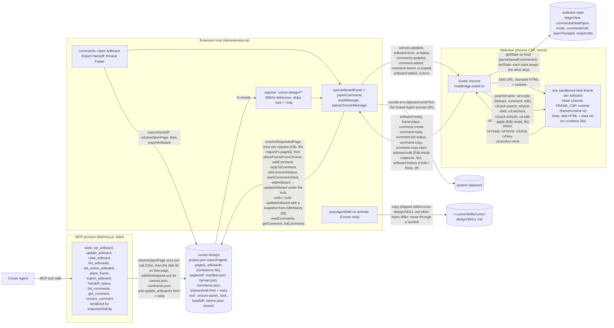

Each blob frame's head starts with the artboard's `<meta charset>`, then `FRAME_CSP` (inline
script and style only, no sources), then the runtime: a nonce'd `<script src>`, even one injected
at runtime or by a script placed before `<meta charset>`, never loads. Style attributes render: the
chrome CSP allows them (`style-src-attr 'unsafe-inline'`, 9a); inline `on*` handlers stay blocked, and a
`url(…)` inside a style is still a blocked subresource. Chrome → frame messages (8d1) go only through `postToFrame`, to registered iframes; the frame
runtime accepts them only from the parent it captured at load; its one write to the design DOM is
`cd:edit-apply`'s Edit-mode preview (9e). Chrome never touches disk or MCP. The MCP
process never touches the panel; it reaches the user only through disk and the watcher.

Every per-page file lives in `.cursor-design/pages/<pageId>/` of the open page that
`project.json` names (10a); the charts below write `pages/<id>/` for it. Handoffs, `tokens.json`,
`assets/`, `.lock` and `.ensure-panel` stay at the `.cursor-design/` root. Every MCP tool and host
entry point resolves the open page first: see Open page and migration (10a).

## Open page and migration (10a)

Shipped in 10a (`src/disk/openPage.ts`). `resolveOpenPage({ workspaceRoot, createIfFresh })` is
called once per call by every entry point and returns the `PageLocation` the op uses. No message
changes: errors reach the user through each caller's existing channel.

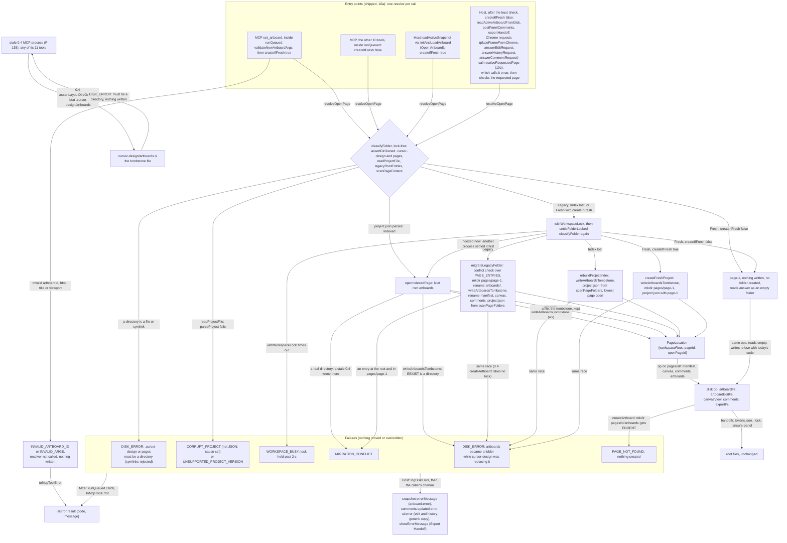

- **Classify.** First match wins: Indexed (`project.json` exists), Legacy (root `artboards` is a
  real directory, or a root `manifest.json`, `canvas.json` or `comments.json` exists), Index lost
  (`scanPageFolders` finds a page folder), else Fresh. The tombstone is never Legacy.
  `scanPageFolders` keeps real directories named by `isPageId`, sorted by number, capped at
  `MAX_PAGES` (the rest are logged and left unlisted).
- **Writes.** An Indexed read writes only a missing tombstone. A Fresh read with `createIfFresh`
  false creates nothing, so every write tool but `set_artboard` refuses with today's code. Inside
  the lock the resolver uses only `mkdir`, `rename`, `writeFile wx` and `writeUtf8`; it never calls
  a lock-taking op, and no caller holds the lock around it.
- **Migration** moves `artboards/` first, then writes the tombstone, then the JSON files, then
  `project.json` (page-1, "Page 1"). A crash at any step resumes: the next call classifies Legacy or
  Index lost and ends in the same layout. Unknown root entries (`picking-harness/`) stay.
  The renames fire the watcher, and its refresh resolves an Indexed folder.
- **Untrusted** workspaces never resolve: the host's trust checks return before it, as before.
- `ponytail:` a 0.4 `addComment` or `placeFrame` already waiting on the lock when a migration runs
  writes an orphan root file afterwards, which 0.5 ignores while `project.json` exists (D5).

## Comments for the Agent (8e)

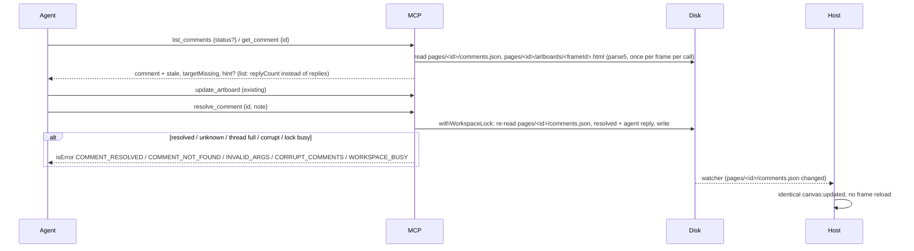

- `stale` and `targetMissing` come from disk only (`commentTarget.ts`): the stored selector runs
  through the in-house `selectMatches` (`selectorMatch.ts`: finder grammar only, one linear walk
  with Chromium's matching rules); a selector outside that grammar, or a match past
  `MAX_MATCH_WORK` element-steps, leaves both flags `null`.
- Every flag read (MCP and panel) shares one path: a parse cached per workspace and frame while
  the HTML text is identical (32 frames at most, oldest evicted), and a 200 ms target-check budget
  timed after the parse. Past the budget, a comment that needs a match reports `null` flags and a
  hint to read again.
- The panel reads the same flags (`readComments`, 8f2) and shows a broken file as its own banner;
  nothing on the canvas or export path reads it, so it never blanks the stage.

## Panel open and handshake

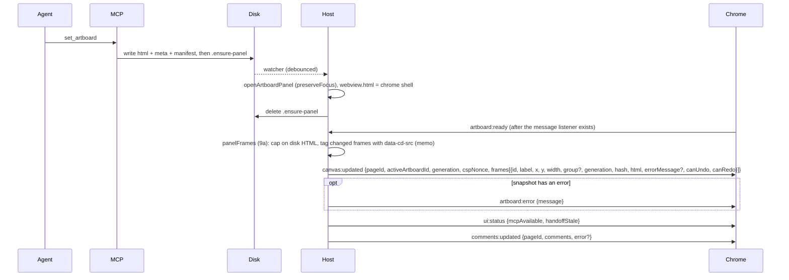

- Before `artboard:ready`, the host keeps only the latest snapshot, status and comment list, and
  flushes them on ready in that order (`createPanelOutbox`). A later `artboard:ready` (webview
  reload) re-sends all three; `ui:status` waits until `mcpAvailable` is known. Answers to a chrome
  request (`comment:added`, `comment:saved`, `ui:error`) are posted only while ready and never
  replayed.
- `pageId` (10b) is the page the snapshot or list was read from: the resolved `PageLocation.pageId`,
  also on a read failure after the resolve. It is `''` only when no page resolved (untrusted
  workspace, no folder, the resolver threw). The outbox holds it with the view and with the list and
  replays both. The chrome drops a message whose `pageId` is neither `''` nor a valid page id. A
  `canvas:updated` with a non-empty `pageId` that differs from the staged page rebuilds the page
  (Page-scoped panel (10b)).
- The panel can also open from the **Open Artboard** command.
- When the panel becomes visible, `reloadVisibleArtboardFromDisk` posts a fresh snapshot and
  comment list. Every watcher refresh re-reads the comment list too; the last read started wins.
- In an untrusted workspace the host posts `frames: []` plus the untrusted error, and `ui:status`
  reports `mcpAvailable: false`. No watcher runs and no artboard script loads.

## Page-scoped panel (10b)

The panel knows which page each snapshot and comment list came from, and every page-bound request
names its page. No page UI yet: the Pages menu is 10d, the Agent's page tools are 10c. A page
change today comes from a hand edit of `project.json`, which the watcher refresh re-reads.

- **Host → chrome.** `canvas:updated.pageId` and `comments:updated.pageId` are the resolved
  `PageLocation.pageId`, or `''` when no page resolved (see Panel open and handshake). `''` is "no
  page", never a page to switch to.
- **Chrome → host.** The 8 page-bound requests carry `pageId`, added in one place by the three post
  functions in `hostBridge.svelte.ts` (the state classes pass their constructor `pageId`). The host
  parser requires `isPageId` before any path is built.
- **Request path.** `answerEditRequest`, `answerHistoryRequest`, `answerCommentRequest` and
  `placeFrameFromChrome` call `resolveRequestedPage({ workspaceRoot, pageId })` once per request, in
  place of `resolveOpenPage`, and every disk op of the request uses the returned `PageLocation`, not
  the page open now. It runs `resolveOpenPage` first (`createIfFresh: false`, so the migration, the
  index rebuild and the lock are unchanged), returns the open page as is, and otherwise requires the
  id in `project.json` `pages` and a `pages/<id>/` directory. An id that fails `isPageId`, is not
  indexed or has no folder throws `PageNotFoundError`. The history keys use the request's `pageId`,
  and `answerHistoryRequest`'s no-I/O "Nothing to undo" path still runs before the resolve.
- **Gone page.** `PageNotFoundError` answers `That page no longer exists.` (`PAGE_GONE_MESSAGE`,
  `panelRequestCopy.ts`): a `ui:error` for edit, history and comment requests. For `frame:place`
  it is the `errorMessage` of the open page's snapshot, so `artboard:error` shows over the open
  page. A page deleted between the check and the write answers the generic disk-error copy
  (`ponytail:` on `resolveRequestedPage`); nothing recreates the folder.
- **Chrome structure.** `App.svelte` keeps the host bridge, the stage page id (`stage.pageId`,
  `''` at first paint), the latest `ui:status` and `comments:updated`, the comment draft slot (with
  its page) and the one comment-UI save `$effect`. `DesignPage.svelte` sits under `{#key
  stage.pageId}` and holds the five per-page objects and today's markup. App reaches the mounted
  page through `bind:this` (`handleHostMessage`, `handleFrameMessage`, `iframes`, `savable`,
  `leave`).
- **Page change.** Only a `canvas:updated` with a non-empty `pageId` that differs from the staged
  page. App reads the mounted page's mode, keeps its draft in the slot (`keptCommentDraft`), calls
  `page.leave()` (open inspector drafts end unsaved: `EditState.discardDrafts`), stages the new id
  with that canvas, the held comment list, the mode and the slot's draft for that page, and
  `flushSync()` mounts the new page before the handler returns. Everything else goes to the mounted
  page, a `canvas:updated` with `pageId: ''` included: it applies as today's error snapshot (no
  remount, no frames, so the mode falls back to Interact by the no-frames rule) and the next
  snapshot for the same page merges as before.
- **Thrown away.** Frame records and iframes, pick, hover and gesture, pins, anchors, the open
  thread, reply composers, edit drafts and queue, `replacedHashes`, the history frame, copy
  feedback, request errors, announcements. **Carried.** The mode, the comments panel's open state,
  `ui:status`, and the comment draft slot (a draft is restored only on its own page, in Comment
  mode, while its frame is live). The stage fits all after a switch. The saved `stageView` and
  `commentDraft` carry their `pageId` and come back only for their own page.
- **Comment lists.** A page draws a list only when `list.pageId` is its own page id or `''`; a
  list for another page is held, never drawn, never sent to a frame as `cd:anchors`.
  `ponytail:` only the latest list is held, so two refreshes whose posts overtake each other can
  leave a page with no comments until the next refresh.
- **Stale answers.** An answer to a request of the old page (`artboard:edited`, `comment:added`,
  `comment:saved`, `ui:copied`, `ui:error`) carries no `pageId`. The new page's objects hold no
  pending request with that `requestId` (UUIDs never cross-match), so they drop it. A comment
  request in flight at a switch is still answered on its page by the host.
- **First page after a webview reload.** The first page with a real id gets the saved reply drafts
  and, when it got no held draft, the saved open thread. The `''` page and later pages get
  neither. The save `$effect` writes nothing while no page is mounted or the page's `pageId` is
  `''`.
- Focus is not moved on a switch (`ponytail:` in `App.svelte`; 10d's menu owns it).

## Agent edit to live frame

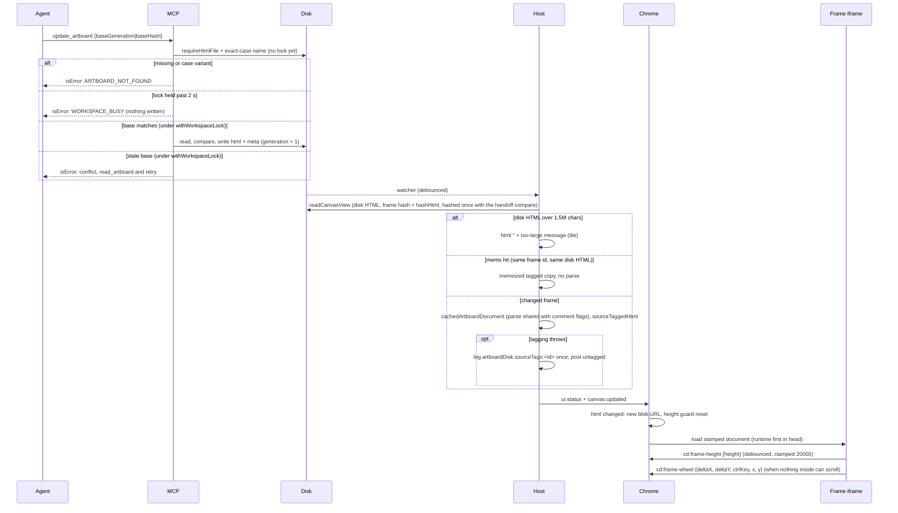

Chrome routes every window message with `routeMessage`: a registered iframe's window is a frame
message (then `parseFrameMessage`), any other opaque-origin sender is dropped, the rest goes to
`parseHostMessage`. Source tags (9a) number every element written in the file by start-tag
order (`sourceTags.ts`; implied elements, `script`/`style`/`title`/`textarea`, template content and SVG
`text` get none) and are deterministic, so an unchanged frame re-posts identical HTML. Disk, export,
`read_artboard`, comment flags and comment selectors never see them; the memo is pruned to the
posted frames (and emptied on the untrusted path). Each `canvas:updated` is merged by `mergeCanvasFrames`: an identical re-post
(tab switch) changes nothing; new html reloads that frame and restarts its height guard.

Stage pan and zoom have three inputs, all through `wheelToView` / `panStage`: a wheel on the stage
(Stage's non-passive listener), `cd:frame-wheel` from a frame, and the root scroll sink. Chromium
latches a trackpad gesture to the out-of-process frame it started over and, once the frame slides
out from under the pointer, hands the rest to the chrome as native root scroll. The chrome is
`position: fixed` over a body with hidden scroll room, so `CanvasState` turns each root scroll into a pan and
scrolls back (`scrollSinkStep`), but only within a second of a frame wheel or an earlier sink pan.

## Panel edit message (9c)

The host side; the chrome side (sender, queue, adopt) is the next section (9e).

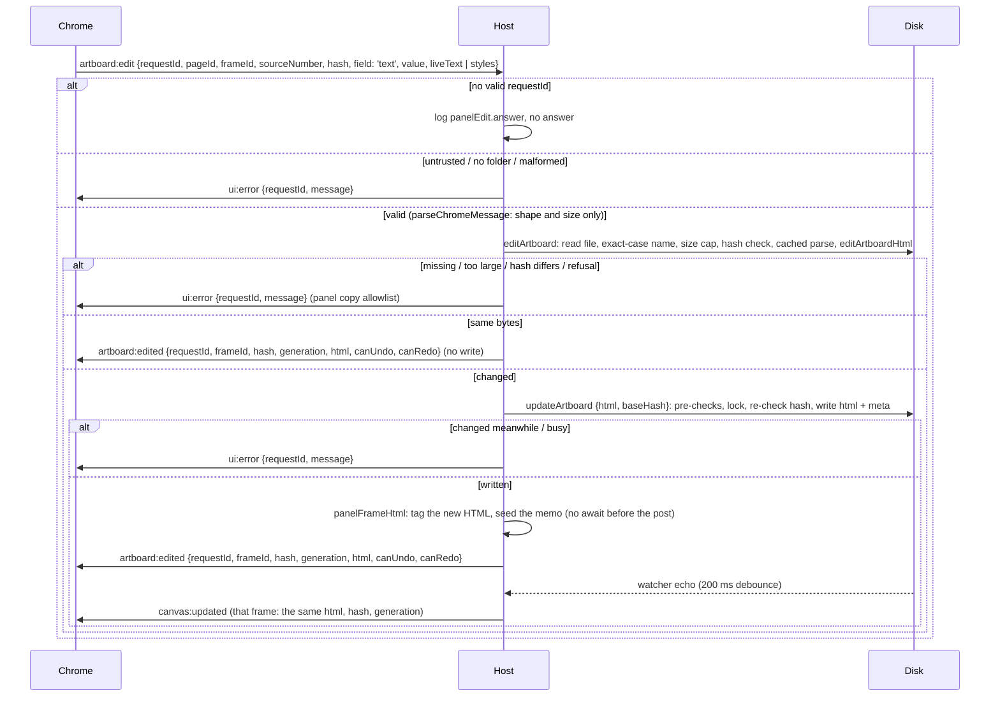

- The answer is posted with no awaited I/O after the write, so it beats the 200 ms echo; a
  write-plus-lock-release over 200 ms, or a refresh that read disk before the write, can still
  post the old frame after it (`ponytail:` in `panelEdit.ts`). The chrome (9e): an echo first
  reloads the frame and the answer is then a no-op; a stale pre-write post is skipped.
- Panel copy comes from `editRequestErrorMessage`, an allowlist: Agent copy (`ConflictError`,
  `CorruptMetaError`) never reaches the panel; refusals carry their own copy (`EditRefusedError`).

## Comment-mode picking (8d1)

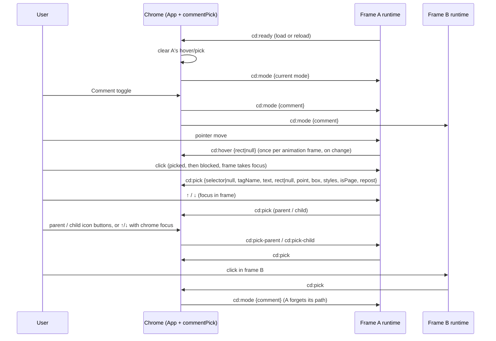

- Chrome drops `cd:hover` and `cd:pick` in Interact mode, and a `cd:pick` whose `edit` does not
  match the mode (`pickCounts`, 9d); a design's own script can post them.
- Only iframe frames hold a pick: a frame that becomes a tile or leaves the stage drops it; an
  empty stage leaves Comment mode.
- Frame data reaches the UI only as chip text and outline geometry (never `{@html}`).

## Edit mode and selection (9d)

The 8d1 picker serves Edit mode too: same blocked events, keys, hover and re-posts. No host
message and no disk write from picking itself; the inspector's fields save through the 9e flow below.

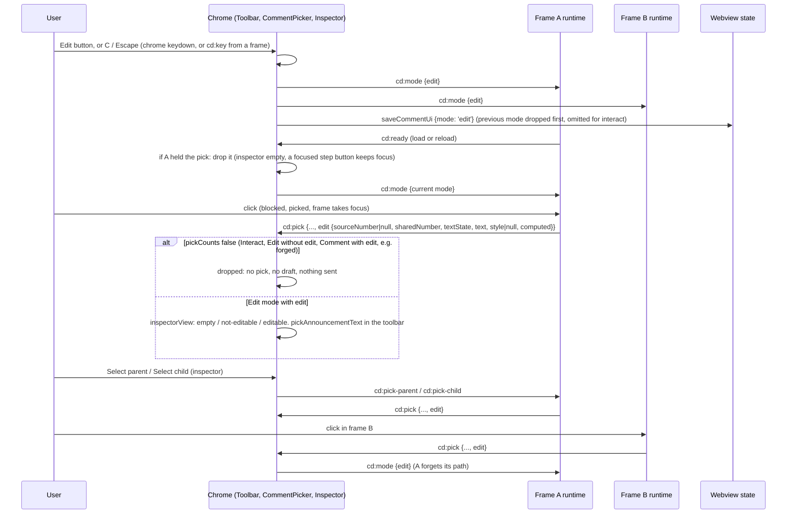

- `parsePickEdit` rejects the whole `cd:pick` on any bad `edit` field and rebuilds it: number
  `null` or a safe non-negative integer, `sharedNumber` only with a number, `text` (raw text node,
  at most `MAX_EDIT_TEXT_CHARS`, `''` unless plain), `style` (at most `MAX_PICK_STYLE_CHARS`).
  Both are the page's own text, shown only as field values. `computed` (9h) is required, its keys
  all in `EDIT_STYLE_FIELDS` and its values all `isSafeStyleValue`, rebuilt from those keys.
- The frame reads the edit target through `getAttribute`, `childNodes`, `querySelectorAll` and
  `getComputedStyle` only (`editTarget.ts`); a page pick edits `body`. The exported `canvas.html` never sends `cd:mode`, so
  this code stays dormant there.
- Inspector sections (`editableSections`, 9i) follow the selection: Text (with Content) for plain
  text, Typography plus an "ask the Agent" hint for mixed content, no text section for a container
  or a void / raw-text element; then Appearance, Spacing (Gap for flex / grid, or when set or
  drafted) and Border (its fields when bordered, else Add border). A text box shows the inline
  value as typed (`inlineValue`: the last declaration, read after the tokenizer's own colon) and
  the computed value from `edit.computed` as placeholder (9h); a select or toggle shows the
  computed value. A set dot marks a field whose section Reset would remove a declaration
  (`clearedProperties`; border parents count for border fields). Not editable for no source number
  or a number shared by two live elements; text over the cap shows a message in place of Content,
  and `style: null` keeps Content beside a style-too-long message.

## Edit fields + save (9e)

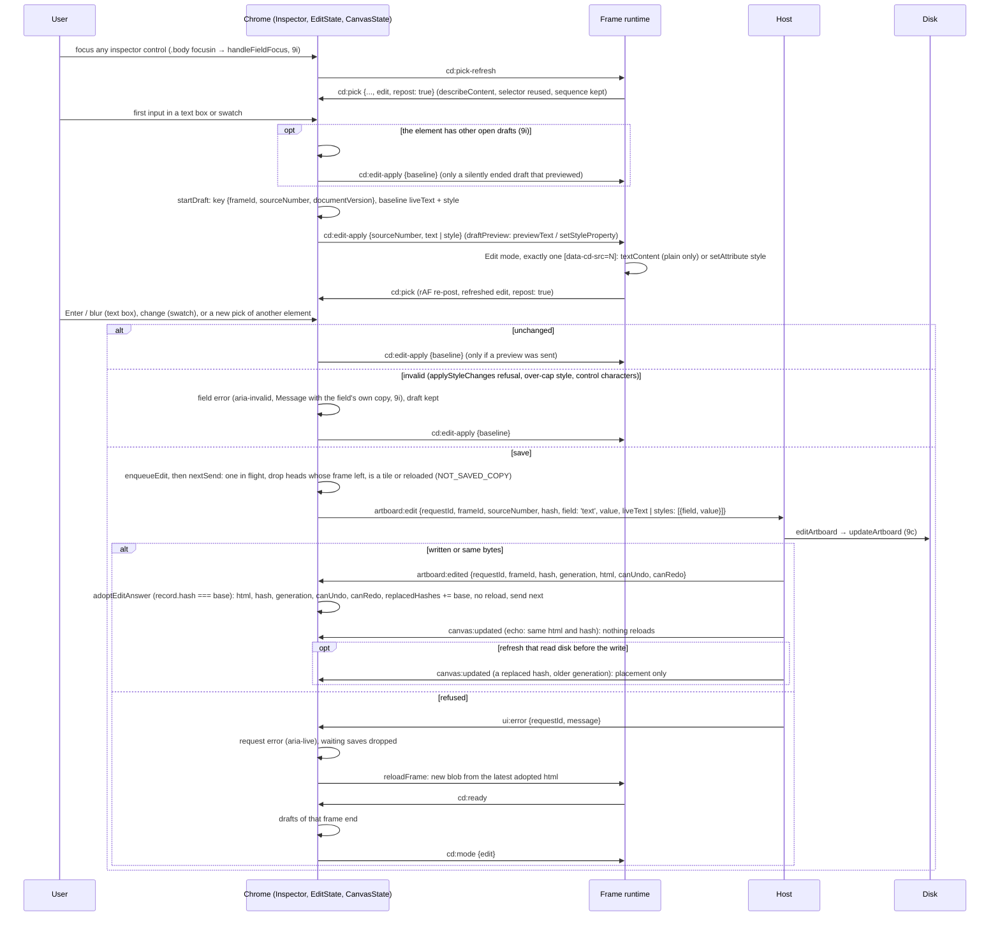

- A draft and its save target the draft's key, never the current pick. In Chromium a click into
  an artboard frame blurs the field (it commits) before the frame's `cd:pick` reaches the chrome;
  a draft still open at a pick of another element commits against its own key (`draftFate`). A
  pick of another element ends an invalid draft with its field's own copy in the request error
  (`invalidDraftCopy`), whether or not the field error was already showing.
- `FrameRecord.html` is the latest known copy; `documentHtml` / `documentVersion` are what the
  iframe was built from, and only they re-run Frame's blob effect. A post whose hash is in
  `replacedHashes` with an older generation is a stale pre-write read; a post with the record's
  own hash keeps the list; any other post is an outside change: it reloads and clears the list.
- An outside change (Agent, editor) reloads the frame as before; open drafts and waiting saves
  for it end with "Not saved: the frame changed. Try again." A refusal's copy wins over that
  copy in the same event. The request error clears on the next commit or a new pick of another
  element and survives a mode switch.
- One `artboard:edit` in flight per panel, no timeout (`ponytail:` in `editRequests.ts`).

## Choices, Reset and Add border (9i)

A choice saves at once, with no draft; Reset and Add border are one save of several changes. All
three share the 9e queue, answer and adopt path, and the 9f undo history.

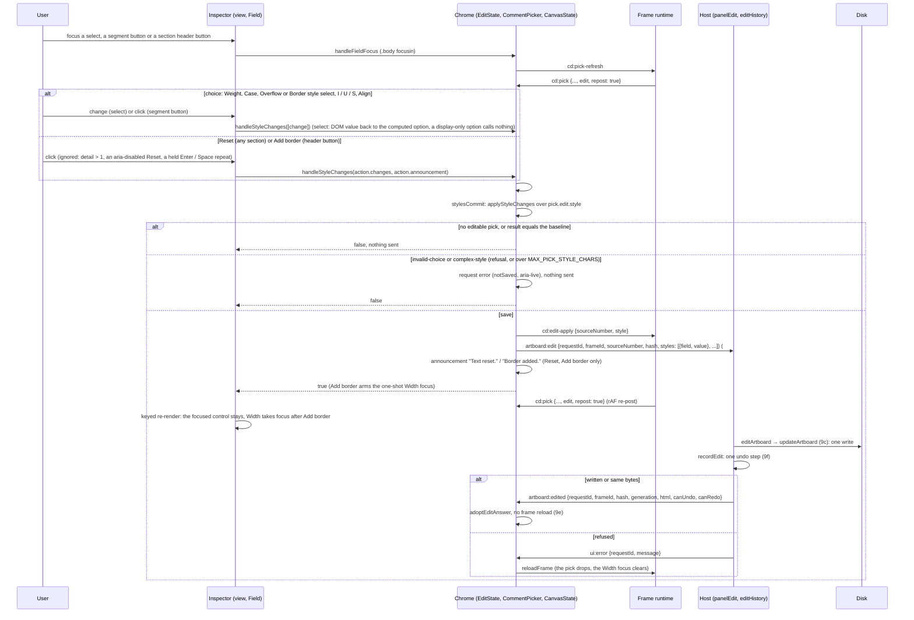

- Reset sends every field of its section with value `''`: Text / Typography's nine style fields
  (never Content), Appearance's four, Spacing's three (Gap even while hidden), Border's three (the
  edit core then also drops `border` / `border-<side>` parents, 9h). Add border sends
  `border-width: 1px` and `border-style: solid`; the colour stays `currentColor`. An inline
  `font`, `text-decoration` or `background` parent is never removed (`ponytail:` in
  `editInspector.ts`).
- One open draft per element: a new draft (`handleFieldInput`) and every `handleStyleChanges`
  call first end the picked element's other open drafts, a valid one through the 9e save, any
  other silently (its preview reverted, no request error). So no save of the element lands between
  a draft's start and its commit, and no preview restores a stale baseline.
- The `cd:pick-refresh` on focus of any control gives a choice the style a design's script may
  have changed since the pick; the baseline is the latest re-posted `pick.edit.style`, so a second
  choice within one animation frame of a preview can read the state before it (`ponytail:` in
  `Inspector.svelte`; disk always gets exactly what was sent).
- Focus: the header button is always mounted and switches label in place (Reset on Border leaves
  focus on it, now Add border). A re-render that removes the focused field (Gap hidden, the border
  fields gone), or Tab's destination (recorded in the capture phase), hands focus to that
  section's header button. Segment and header buttons ignore a held Enter / Space repeat
  (`ignoreKeyRepeat`).

## Undo / redo (9f)

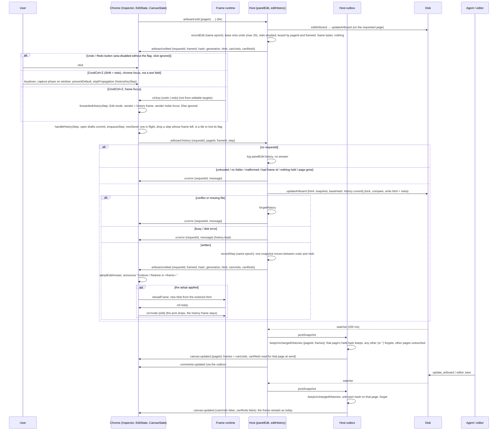

- History lives in extension memory (`editHistory.ts`): per page and frame (`{pageId, frameId}`
  at every function, 10b), up to 20 whole-file steps
  between undo and redo plus the file last written. It is cleared on panel dispose and on any
  workspace-folder change (`clearEditHistories`, which bumps an epoch so a request still awaiting
  the lock records nothing). It survives the webview being hidden: the outbox replays
  `canvas:updated` with flags read at send time for the posted page.
- The outside-change rule (`keepUnchangedHistories`) checks only the posted snapshot's page and
  leaves every other page's histories alone, so a page that is not on stage keeps its history until
  the panel closes, and the same frame id on two pages has two histories. It accepts any hash the
  history holds, so a stale refresh (the 9c ceiling) does not wipe it; an outside write that recreates a held state is caught at the next step's
  checked write.
- Undo / Redo act on the frame of the latest accepted Edit-mode pick from a frame that holds focus
  (`historyFrameId`; a pick without focus, e.g. one a design script posts, never moves it, F-146),
  kept after the pick drops and across mode switches, lost on a webview reload.
- The host trusts the chrome's one-in-flight queue (`ponytail:` in `panelEdit.ts`): two
  overlapping steps after a webview reload can forget a valid history. No data loss.
- The keyboard paths ship only as far as the 9f F5 spike in Cursor allows (the spec records it).

## Comment mode and popover (8f1)

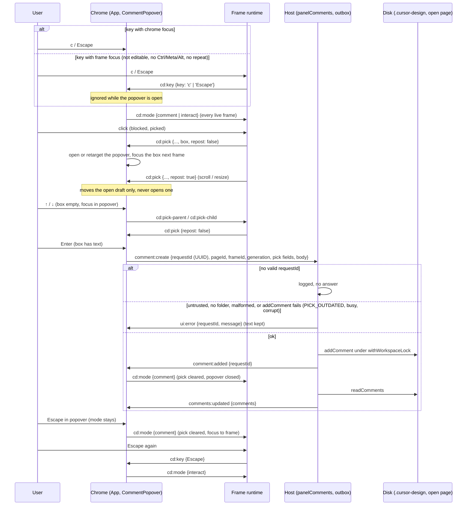

- An answer whose `requestId` is not the pending one is ignored; Cancel is disabled while a save
  is pending. Toggling the mode drops the draft, so a late answer finds nothing.
- An Agent edit reloads the frame and drops the pick; the popover keeps its text and greys out
  the parent and child buttons, and the next Add gets "Pick it again" (`PICK_OUTDATED`).
- A forged `cd:key` from a design script cannot discard a draft. A forged user `cd:pick` can
  retarget it; the text is kept and the chip changes.
- After Add, the new comment's pin arrives with that `comments:updated` (8f2, next section).

## Pins (8f2)

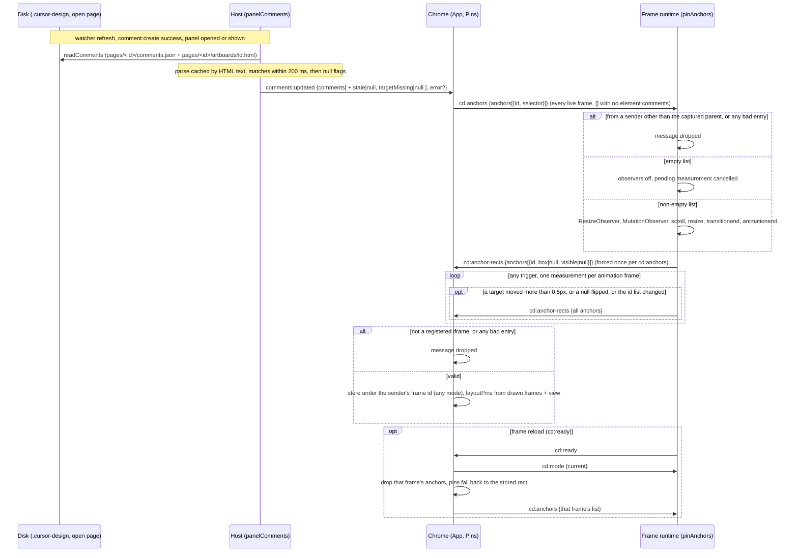

- A pin is placed only for a comment on a live iframe frame. Frame-local point: a page comment is
  its fraction of the frame record; an element comment is its fraction of the live `box`, or of
  the stored `rect` until the frame answers or when `box` is `null`.
- A pin is hidden when the live `box` exists and `visible` is `null` or the point is outside it,
  and when the point is outside the frame. A forged `cd:anchor-rects` only moves or hides that
  frame's own pins: it is stored under the sender's id and never draws over a neighbor frame.
- Badge (`pinBadge`): none for a resolved comment, else `missing` (live `box: null` or
  `targetMissing: true`), else `stale`, else `unchecked` (both flags `null`).
- `cd:anchors` is ignored by `commentPicking`, so it never steps an open pick. The pin layer is
  `inert` while a draft is open, so a click there picks the element under it.
- A pin click opens `CommentThread` with no message to the host. Escape or Close returns focus to
  the pin. The thread closes when its comment or pin goes away, or a draft opens; focus inside it
  then moves to the stage viewport. One `$effect.pre` in `PinThread` closes it whenever `pins` no longer
  holds it, before it unmounts, so it never stays open while hidden.

## Comments panel (8g)

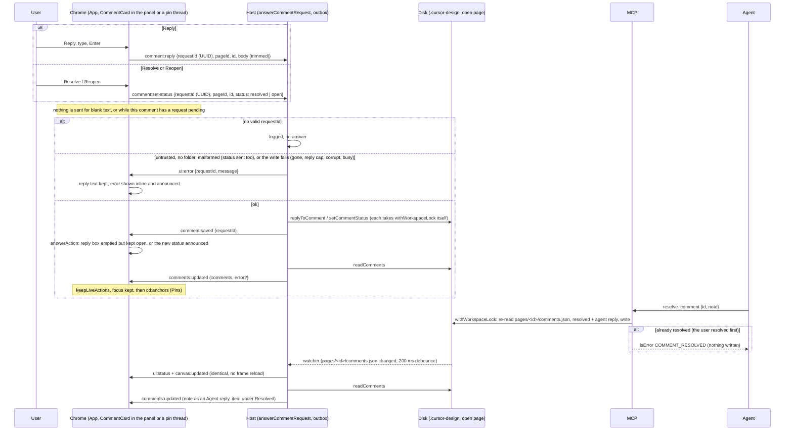

- `openArtboardPanel` hands every message that claims `comment:create`, `comment:reply` or
  `comment:set-status` (`commentRequestType`, read before any parse) to `answerCommentRequest`,
  valid or not. It checks the `requestId`, trust, the folder, then a parse whose type must match
  the claim, then writes. `comment:create` takes the same handler and is unchanged on the wire
  (answered by `comment:added`, 8f1).
- The answer is posted before `postPanelComments`, so `comment:saved` arrives before the
  `comments:updated` it causes; a failure posts no refresh. A deleted comment reads "This comment
  no longer exists." (`commentRequestErrorMessage`), never the Agent copy.
- A user Resolve after the Agent's is a no-op that writes nothing and still answers
  `comment:saved`. A reply keeps the status. The host's own write also fires the watcher, which
  posts the same snapshot and list again.
- Chrome: one request in flight per comment, matched only by `requestId`. A `ui:error` is offered
  to both the draft (8f1) and the actions; UUIDs never cross-match. A `comments:updated` without
  `error` drops actions for comments no longer listed; one with `error` keeps them, so typed text
  survives a failed read. A webview reload resets the actions (a lost answer leaves `pending` set
  until then, `ponytail:`).
- The panel and the pin thread render the same `CommentCard`, and actions are keyed by comment
  id, so a reply box open in one is open in the other with the same text. The panel is always
  mounted and renders its list only while open. When an update rebuilds the focused item and focus
  fell to body, it goes back to the same control, but only while the webview has focus.
- Panel state: the toolbar toggle saves `commentsPanelOpen` (`saveCommentsPanelOpen`) in the one
  webview state record beside `stageView`; each save keeps the other keys. A missing or
  non-boolean value reads as closed. Nothing new on disk.
- Comment UI across a tab switch (fix, chrome-only; 9d renamed the mode key to `mode`, Comment or Edit): one `$effect` saves `mode`,
  `commentDraft` (with its `body`; never a pending one), `openThreadId` and `replyDrafts` through
  `saveCommentUi`, omitting default keys; `saveCommentUi` also drops the pre-9d `commentMode` key. On load `parseSavedCommentUi` drops bad keys one by one.
  Comment mode and reply text come back at once; the draft is held until the first
  `canvas:updated` (`resolveHeldDraft`: back on a live iframe frame, else dropped), the thread
  until its pin is placed (`resolveHeldThread`). A restored item takes focus only when nothing else
  has it. No message to the host.
- Click to jump is chrome-only, with no message to the host or a frame. The target chip of a
  comment on a live iframe frame runs `jumpTarget` from the frame's latest `cd:anchor-rects` (else
  the stored rect), then `jumpStageView` (keeps the zoom, zooms out only to fit) through
  `commitStageView`, which clamps and saves `stageView`. `Overlay` draws the `data-cd-flash`
  outline for `JUMP_FLASH_MS` (1.5 s), following pan, zoom and later `cd:anchor-rects`. Nothing
  scrolls inside the frame.

## Copy for Agent (8h)

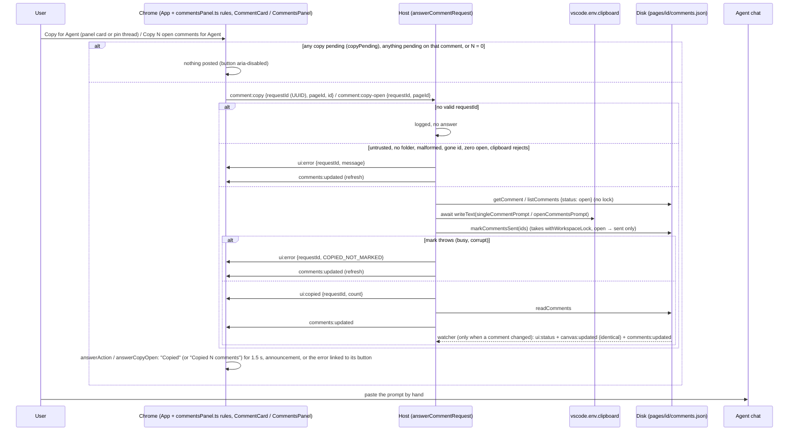

- The prompt is built in the host from disk (`commentPrompt.ts`): artboard, version and styles
  never reach the chrome. Both templates are locked word for word and pinned by a literal test.
  Frame-sourced fields (`artboard`, `selector`, `text`) pass `toOneLine` (control, format and
  white-space runs become one space, capped, no lone surrogate); `{text}` also loses its `"`. The
  body keeps its newlines (the user's own text, `ponytail:`).
- The clipboard is written before `markCommentsSent`, so a rejected write marks nothing sent.
  `count` is how many comments moved open → sent: 0 for a re-copy, or when the Agent resolved them
  first (they stay resolved). `markCommentsSent` writes nothing when nothing changed, so a re-copy
  fires no watcher.
- Copy N open comments for Agent lists the open ids in the page's `comments.json` (creation) order. Zero open answers
  "There are no open comments to copy." with no clipboard write. Every copy answer, success or
  failure, is followed by a `comments:updated`, so a stale N corrects itself.
- Chrome: one copy at a time across the panel and threads (`copyPending`), so the clipboard holds
  the prompt of the last answered copy. `ui:copied` matches only a pending copy and never touches a
  reply draft. `comments:updated` never clears the batch's pending request. A lost answer keeps
  every Copy button blocked until a webview reload (the 8g `ponytail:`).

## Frame drag / resize (8c)

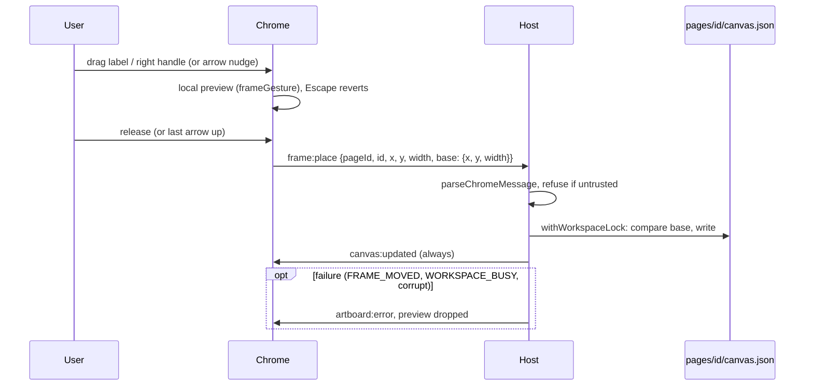

An Agent `place_frame` takes the same lock. If it lands mid-drag, the next `canvas:updated`
settles the gesture to disk (the Agent wins).

## Export

`export_artboard` (MCP) and the **Export Handoff** command both resolve the open page, then call
`exportArtboard({ page })` in the disk lib. It scans, reads and refreshes that page's files only.

- They write `handoff/<exportId>/` at the `.cursor-design/` root: `IMPLEMENT.md`, `canvas.html`,
  `tokens.json` (from the root `tokens.json`), and `<group>/<id>/index.html`. `IMPLEMENT.md` step 2
  (MCP unavailable) names the page's `.cursor-design/pages/<pageId>/artboards/` (10a).
- They record `lastExport` in the page's `pages/<id>/manifest.json`.
- The scan and the leaf writes take no lock. The tail does: under `withWorkspaceLock`, every stale
  frame's HTML and strict meta are re-read and the manifest is re-read before any write. A meta is
  refreshed only if its HTML and meta are unchanged since the scan, and the manifest is written from
  the fresh copy plus `lastExport`. `set_artboard` / `set_active_artboard` still write the manifest
  unlocked (ponytail in `exportFs.ts`).
- `canvas.html` embeds the frame runtime and a preview controller that accepts only
  `cd:frame-height` and `cd:frame-wheel` from its own frames. It never sends `cd:anchors`, so the
  runtime's pin observers stay off there.
- `handoff_status`, and `ui:status.handoffStale`, compare the current frames with `lastExport`.

## Message contract (shipped)

| Direction | Message | Payload |
|---|---|---|
| chrome → host | `artboard:ready` | none |
| chrome → host | `frame:place` | `{pageId, id, x, y, width, base: {x, y, width}}` |
| chrome → host | `comment:create` | `{requestId, pageId, frameId, generation, selector, tagName, text, rect \| null, point, box, styles, isPage, body}` |
| chrome → host | `comment:reply` | `{requestId, pageId, id, body}` |
| chrome → host | `comment:set-status` | `{requestId, pageId, id, status: 'open' \| 'resolved'}` |
| chrome → host | `comment:copy` | `{requestId, pageId, id}` (8h) |
| chrome → host | `comment:copy-open` | `{requestId, pageId}` (8h) |
| chrome → host | `artboard:edit` | `{requestId, pageId, frameId, sourceNumber, hash}` plus either `{field: 'text', value, liveText}` or `{styles: StyleChange[]}`, `StyleChange` `{field, value}` with `field` in `EDIT_STYLE_FIELDS` (9c; `styles` 9h: 1..`EDIT_STYLE_FIELDS.length` distinct fields set or cleared together, one write and one undo step; a message with the text fields and `styles` parses as text; the pre-9h single-style shape is malformed; sent by the Edit-mode inspector since 9e, one in flight per panel; a choice sends one change, a section Reset or Add border several, 9i) |
| chrome → host | `artboard:history` | `{requestId, pageId, frameId, step: 'undo' \| 'redo'}` (9f; the inspector's Undo / Redo or Cmd/Ctrl+Z; one in flight per panel, shared with `artboard:edit`) |
| host → chrome | `canvas:updated` | `{pageId, activeArtboardId, generation, cspNonce, frames[]}` (`pageId` 10b: the page the snapshot was read from, `''` when no page resolved, else a valid page id; each frame's `html` is the disk HTML with host-added `data-cd-src="N"` numbers, 9a; each frame's `hash` is `hashHtml` of the disk HTML, `''` when unreadable, 9c; each frame's `canUndo` / `canRedo` is read from the undo history when the outbox sends, 9f) |
| host → chrome | `artboard:error` | `{message}` (safe copy) |
| host → chrome | `ui:status` | `{mcpAvailable, handoffStale}` |
| host → chrome | `comments:updated` | `{pageId, comments[], error?}` (`pageId` 10b: as on `canvas:updated`, `''` always with no comments; each comment has `stale` and `targetMissing`, `true`, `false` or `null` = unchecked) |
| host → chrome | `comment:added` | `{requestId}` |
| host → chrome | `comment:saved` | `{requestId}` (answer to `comment:reply` / `comment:set-status`, posted before the `comments:updated` it causes) |
| host → chrome | `ui:copied` | `{requestId, count}` (answer to `comment:copy` / `comment:copy-open`; `count` = comments moved open → sent; posted before the `comments:updated` it causes) |
| host → chrome | `artboard:edited` | `{requestId, frameId, hash, generation, html, canUndo, canRedo}` (9c answer to `artboard:edit`, 9f also to `artboard:history`; `html` = the tagged copy the echo will post; the chrome adopts it without a reload, 9e, and reloads the frame after a step, 9f) |
| host → chrome | `ui:error` | `{message, requestId?}` (safe copy) |
| frame → chrome | `cd:frame-height` | `{height}` |
| frame → chrome | `cd:frame-wheel` | `{deltaX, deltaY, ctrlKey, x, y}` (frame-local CSS px) |
| frame → chrome | `cd:ready` | none |
| frame → chrome | `cd:hover` | `{rect \| null}` (frame-local CSS px) |
| frame → chrome | `cd:pick` | `{selector \| null, tagName, text, rect \| null, point, box, styles, isPage, repost, edit?}` (selector from finder inside the frame; `point` relative to the target's box, `box` its unclipped size; `repost` true for a scroll or resize re-post; `edit` `{sourceNumber \| null, sharedNumber, textState, text, style \| null, computed}` only in Edit mode, 9d; `style` `''` when absent, `null` only over the cap, 9e; `textState` `'plain' \| 'mixed' \| 'elements' \| 'too-long'` and `computed` (the edit target's computed value per `EDIT_STYLE_FIELDS` key, empty and unsafe values omitted), 9h) |
| frame → chrome | `cd:key` | `{key: 'c' \| 'Escape' \| 'undo' \| 'redo'}` (frame focus, not editable, no Alt or repeat; C / Escape without Ctrl/Meta; undo / redo are Cmd/Ctrl+Z and Cmd/Ctrl+Shift+Z, 9f, acted on only from the focused history frame in Edit mode) |
| frame → chrome | `cd:anchor-rects` | `{anchors: [{id, box \| null, visible \| null}]}` (frame-local CSS px; `box` unclipped, `visible` clipped by every ancestor whose overflow is not visible (html and body excluded) and the frame viewport; `box: null` requires `visible: null`) |
| chrome → frame | `cd:mode` | `{mode: 'interact' \| 'comment' \| 'edit'}` |
| chrome → frame | `cd:pick-parent`, `cd:pick-child` | none |
| chrome → frame | `cd:anchors` | `{anchors: [{id, selector}]}` (the frame's element comments, every status; replaces its previous list) |
| chrome → frame | `cd:pick-refresh` | none (9e, Edit mode only; sent when focus enters any inspector control, 9i; the frame re-describes its pick, selector reused, and re-posts it with `repost: true`) |
| chrome → frame | `cd:edit-apply` | `{sourceNumber, text}` or `{sourceNumber, style}` (9e, Edit mode only; the live preview of the one element with that number; display only) |

This table is the normative message contract; rule 02 keeps only the cross-cutting invariants.
The `pageId` on the 8 chrome → host rows is required and must pass `isPageId` (10b): a missing or
malformed one makes the message malformed, with that message's existing refusal copy. Answers
(`artboard:edited`, `comment:added`, `comment:saved`, `ui:copied`, `ui:error`) carry no `pageId`.
If the table and the code disagree, fix whichever is wrong. `frameMessages.test.ts` fails when
this section's `cd:*` names differ from the frame message constants, or its `host → chrome` /
`chrome → host` names differ from the `HostMessage` / `ChromeMessage` types.
